# Sistema de Moeda Estudantil — Projeto de Software

**PUC Minas — Engenharia de Software**
Laboratórios 3 e 4 (Releases 01 e 02) — Segundo Semestre/2026
Disciplina: Projeto de Software — Profa. Milena Menezes Adão
Integrantes: João Pedro Maciel de Oliveira

---

## Sumário

1. [Visão Geral](#1-visão-geral)
2. [Atores](#2-atores)
3. [Regras de Negócio](#3-regras-de-negócio)
4. [Casos de Uso](#4-casos-de-uso)
5. [Histórias de Usuário](#5-histórias-de-usuário)
6. [Diagrama de Classes](#6-diagrama-de-classes)
7. [Diagrama de Componentes](#7-diagrama-de-componentes)
8. [Modelo ER](#8-modelo-er)
9. [Estratégia de Acesso ao Banco de Dados](#9-estratégia-de-acesso-ao-banco-de-dados)
10. [Padrões Utilizados](#10-padrões-utilizados)
11. [API REST](#11-api-rest)
12. [Como Executar](#12-como-executar)
13. [Estrutura do Repositório](#13-estrutura-do-repositório)
14. [Andamento das Sprints](#14-andamento-das-sprints)
15. [Diagramas de Sequência e Visão Geral de Interação](#15-diagramas-de-sequência-e-visão-geral-de-interação)

---

## 1. Visão Geral

Sistema para estimular o reconhecimento do mérito estudantil por meio de uma **moeda virtual**. Professores distribuem moedas aos seus alunos como reconhecimento (bom comportamento, participação em aula etc.), e os alunos trocam essas moedas por **vantagens** (produtos e descontos) oferecidas por **empresas parceiras**.

### Tecnologias

| Camada | Tecnologia |
|---|---|
| **View** (front-end) | React 19 + Vite, Axios, React Router |
| **Controller** (back-end) | Java 21 + Spring Boot 3.5 — Spring Web (REST) + Bean Validation |
| **Model** (back-end) | Services com as regras de negócio + entidades JPA |
| **Persistência** | Spring Data JPA / Hibernate (ORM) com repositórios no padrão DAO; esquema versionado com Flyway |
| **Banco de dados** | MySQL 8 (H2 em memória, modo MySQL, para testes e para rodar sem instalar o MySQL) |
| **Autenticação** | Spring Security + JWT (biblioteca JJWT), senhas armazenadas com BCrypt |
| **E-mail** | Spring Boot Mail (`JavaMailSender`) via SMTP |
| **Testes** | JUnit 5, Spring Boot Test (MockMvc, `@DataJpaTest`), Mockito |
| **Modelagem** | PlantUML |

**Arquitetura:** MVC, com o back-end organizado nas camadas `controller` → `service` → `repository` → `model`.

---

## 2. Atores

| Ator | Tipo | Descrição |
|---|---|---|
| **Aluno** | Primário | Cadastra-se no sistema, consulta o extrato, recebe moedas e as troca por vantagens. |
| **Professor** | Primário | Pré-cadastrado pela instituição. Recebe 1.000 moedas por semestre e as distribui aos seus alunos. |
| **Empresa Parceira** | Primário | Cadastra-se no sistema e mantém as vantagens oferecidas aos alunos. Recebe e-mail a cada resgate para conferência. |
| **Tempo** (início do semestre) | Secundário | Dispara o crédito semestral de moedas aos professores. |
| **Serviço de E-mail** | Secundário (externo) | Entrega as notificações de recebimento de moedas, os cupons de resgate e os avisos às empresas parceiras. |

> Aluno, Professor e Empresa Parceira são especializações de **Usuário**, que concentra o login (e-mail) e a senha.
>
> **Instituições de ensino** e **professores** não são atores com casos de uso de manutenção: são pré-cadastrados por carga inicial de dados, a partir da lista enviada pela instituição no momento da parceria.

---

## 3. Regras de Negócio

| ID | Regra |
|---|---|
| **RN01** | O cadastro de aluno exige nome, e-mail, CPF, RG, endereço, instituição de ensino e curso. CPF e e-mail são únicos no sistema. |
| **RN02** | As instituições de ensino participantes já estão pré-cadastradas; o aluno seleciona a sua no cadastro. |
| **RN03** | Os professores são pré-cadastrados (lista enviada pela instituição) com nome, CPF, departamento e a instituição à qual pertencem. Não há auto-cadastro de professor. |
| **RN04** | A cada semestre, cada professor recebe **1.000 moedas**, somadas ao saldo corrente (o saldo não distribuído é acumulado). O crédito ocorre uma única vez por semestre. |
| **RN05** | Para enviar moedas, o professor deve ter **saldo suficiente** e informar o aluno destinatário, a quantidade (inteiro positivo) e o **motivo** do reconhecimento (mensagem aberta, obrigatória). |
| **RN06** | O professor só pode enviar moedas a alunos da **mesma instituição** de ensino. |
| **RN07** | Ao receber moedas, o aluno é **notificado por e-mail**. |
| **RN08** | O extrato exibe o saldo atual e as transações da conta: para o professor, créditos semestrais e envios; para o aluno, recebimentos e resgates. |
| **RN09** | Uma vantagem possui nome, descrição, **foto** e **custo em moedas** (inteiro positivo), e pertence a uma empresa parceira. |
| **RN10** | Para resgatar uma vantagem, o aluno deve ter saldo suficiente; o custo é **debitado** do seu saldo. |
| **RN11** | Cada resgate gera um **código único**. É enviado um e-mail de cupom ao aluno e um e-mail à empresa parceira, ambos com esse código, para conferência na troca presencial. |
| **RN12** | Alunos, professores e empresas parceiras têm login e senha. Todas as funcionalidades exigem autenticação, exceto o próprio login e o auto-cadastro de aluno e de empresa parceira. |

> **Notas de modelagem**
> - O enunciado não lista e-mail para o professor, mas ele precisa de login; adotamos o **e-mail como login** para todos os usuários, por isso o atributo fica em `Usuario`.
> - **RN06** é a nossa leitura de "distribuídas aos *seus* alunos". Caso o entendimento mude, a regra fica isolada em `MoedaService` e o modelo não precisa ser alterado.
> - O crédito semestral é registrado como uma transação (`CreditoSemestral`), o que mantém o extrato do professor completo e impede crédito em duplicidade no mesmo semestre (RN04).
> - **Exceções públicas à RN12:** a lista de instituições, necessária no formulário de auto-cadastro, e as fotos das vantagens, porque a tag `` do navegador não envia o token.

---

## 4. Casos de Uso

### 4.1 Diagrama

Fonte PlantUML: [`docs/sprint-03/casos-de-uso.puml`](docs/sprint-03/casos-de-uso.puml) · v1: [`docs/sprint-01/casos-de-uso.puml`](docs/sprint-01/casos-de-uso.puml)

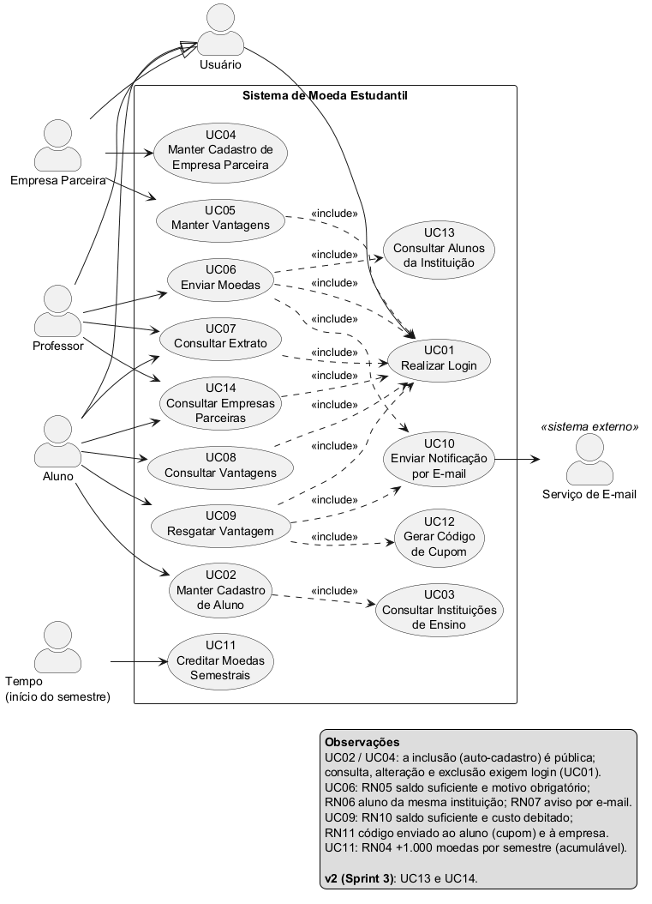

### 4.2 Lista de Casos de Uso

| ID | Caso de Uso | Ator Principal | Regras |
|---|---|---|---|
| UC01 | Realizar Login | Usuário (Aluno, Professor, Empresa Parceira) | RN12 |
| UC02 | Manter Cadastro de Aluno | Aluno | RN01, RN02 |
| UC03 | Consultar Instituições de Ensino | — (incluído por UC02) | RN02 |
| UC04 | Manter Cadastro de Empresa Parceira | Empresa Parceira | RN12 |
| UC05 | Manter Vantagens | Empresa Parceira | RN09 |
| UC06 | Enviar Moedas | Professor | RN05, RN06, RN07 |
| UC07 | Consultar Extrato | Aluno, Professor | RN08 |
| UC08 | Consultar Vantagens | Aluno | RN09 |
| UC09 | Resgatar Vantagem | Aluno | RN10, RN11 |
| UC10 | Enviar Notificação por E-mail | Serviço de E-mail (secundário) | RN07, RN11 |
| UC11 | Creditar Moedas Semestrais | Tempo (secundário) | RN04 |
| UC12 | Gerar Código de Cupom | — (incluído por UC09) | RN11 |
| UC13 | Consultar Alunos da Instituição | — (incluído por UC06) | RN06 |
| UC14 | Consultar Empresas Parceiras | Aluno, Professor | RN12 |

**Relacionamentos:**

- UC05, UC06, UC07, UC08, UC09 e UC14 **incluem** UC01 (Realizar Login).
- UC02 e UC04: a inclusão (auto-cadastro) é pública; consulta, alteração e exclusão exigem login (RN12).
- UC02 **inclui** UC03 — o aluno escolhe uma instituição pré-cadastrada.
- UC06 **inclui** UC10 — o aluno é notificado ao receber moedas.
- UC06 **inclui** UC13 — o professor escolhe entre os alunos da sua instituição.
- UC09 **inclui** UC12 e UC10 — o código é gerado e enviado ao aluno (cupom) e à empresa parceira.

> **Modelo atualizado na Sprint 3:** UC13 e UC14 surgiram na implementação. O professor precisava de uma lista para escolher o aluno, sem acesso aos dados pessoais dele, e a listagem de empresas do CRUD precisava de um ator, já que cada empresa só altera os próprios dados.

---

## 5. Histórias de Usuário

### 5.1 Autenticação

#### US01 — Realizar login
> **Como** usuário do sistema (aluno, professor ou empresa parceira),
> **quero** acessar o sistema com meu e-mail e minha senha,
> **para que** somente eu realize operações na minha conta.

**Critérios de aceitação**
- Dado que informo credenciais válidas, então acesso a área correspondente ao meu perfil.
- Dado que informo e-mail ou senha incorretos, então recebo uma mensagem de erro genérica e continuo na tela de login.
- Nenhuma funcionalidade, exceto login e auto-cadastro, é acessível sem autenticação (RN12).

**Casos de uso:** UC01

---

### 5.2 Aluno

#### US02 — Cadastrar-me como aluno
> **Como** aluno,
> **quero** me cadastrar informando nome, e-mail, CPF, RG, endereço, instituição de ensino, curso e senha,
> **para que** eu possa participar do sistema de mérito e receber moedas.

**Critérios de aceitação**
- Todos os campos são obrigatórios (RN01).
- A instituição é escolhida de uma lista de instituições pré-cadastradas (RN02).
- O cadastro é recusado se o CPF ou o e-mail já estiverem em uso.
- Ao concluir, minha conta é criada com saldo de 0 moedas.

**Casos de uso:** UC02, UC03

#### US03 — Gerenciar meu cadastro de aluno
> **Como** aluno,
> **quero** consultar, alterar e excluir meus dados cadastrais,
> **para que** minhas informações estejam sempre corretas.

**Critérios de aceitação**
- Só tenho acesso aos meus próprios dados, após login.
- As mesmas validações do cadastro valem na alteração.
- A exclusão pede confirmação e encerra meu acesso ao sistema.

**Casos de uso:** UC02

#### US04 — Ser notificado ao receber moedas
> **Como** aluno,
> **quero** receber um e-mail sempre que um professor me enviar moedas,
> **para que** eu saiba que fui reconhecido e por qual motivo.

**Critérios de aceitação**
- O e-mail informa o professor, a quantidade de moedas e o motivo (RN07).
- Falha no envio do e-mail é registrada em log e não desfaz a transação.

**Casos de uso:** UC06, UC10

#### US05 — Consultar meu extrato
> **Como** aluno,
> **quero** consultar meu saldo e o histórico de moedas recebidas e trocadas,
> **para que** eu acompanhe quanto tenho disponível para resgate.

**Critérios de aceitação**
- O extrato exibe o saldo atual (RN08).
- Cada recebimento mostra data, professor, quantidade e motivo.
- Cada resgate mostra data, vantagem, custo e código do cupom.
- As transações são exibidas da mais recente para a mais antiga.

**Casos de uso:** UC07

#### US06 — Consultar vantagens disponíveis
> **Como** aluno,
> **quero** ver as vantagens oferecidas pelas empresas parceiras, com foto, descrição e custo,
> **para que** eu escolha em que trocar minhas moedas.

**Critérios de aceitação**
- Somente vantagens ativas são listadas.
- Cada vantagem exibe nome, descrição, foto, custo em moedas e empresa parceira (RN09).
- Vantagens com custo maior que o meu saldo aparecem indicadas como indisponíveis para mim.

**Casos de uso:** UC08

#### US07 — Resgatar uma vantagem
> **Como** aluno,
> **quero** trocar minhas moedas por uma vantagem,
> **para que** eu possa usufruir do benefício na empresa parceira.

**Critérios de aceitação**
- O resgate é recusado se meu saldo for menor que o custo da vantagem (RN10).
- Em caso de sucesso, o custo é debitado do meu saldo e o resgate aparece no meu extrato.
- O sistema gera um código único de cupom (RN11).
- Recebo um e-mail de cupom com o código, a vantagem e a empresa parceira.

**Casos de uso:** UC09, UC12, UC10

---

### 5.3 Professor

#### US08 — Receber moedas semestrais
> **Como** professor,
> **quero** receber 1.000 moedas no início de cada semestre, somadas ao saldo que eu ainda tiver,
> **para que** eu possa reconhecer meus alunos ao longo do semestre.

**Critérios de aceitação**
- No início do semestre, 1.000 moedas são creditadas na conta de cada professor (RN04).
- O saldo não distribuído no semestre anterior é mantido (acumulativo).
- O crédito não ocorre duas vezes no mesmo semestre.
- O crédito aparece no meu extrato.

**Casos de uso:** UC11

#### US09 — Enviar moedas a um aluno
> **Como** professor,
> **quero** enviar moedas a um aluno informando a quantidade e o motivo,
> **para que** ele seja reconhecido pelo bom comportamento ou pela participação em aula.

**Critérios de aceitação**
- Só posso selecionar alunos da minha instituição (RN06).
- A quantidade deve ser um inteiro positivo e não pode exceder meu saldo (RN05).
- O motivo é obrigatório (RN05).
- Em caso de sucesso, o valor é debitado do meu saldo e creditado no saldo do aluno, e o aluno é notificado por e-mail (RN07).

**Casos de uso:** UC06, UC10

#### US10 — Consultar meu extrato
> **Como** professor,
> **quero** consultar meu saldo e o histórico de moedas recebidas e enviadas,
> **para que** eu acompanhe como distribuí as moedas entre os alunos.

**Critérios de aceitação**
- O extrato exibe o saldo atual (RN08).
- Cada envio mostra data, aluno, quantidade e motivo.
- Cada crédito semestral mostra o semestre e a quantidade.

**Casos de uso:** UC07

---

### 5.4 Empresa Parceira

#### US11 — Cadastrar minha empresa como parceira
> **Como** empresa parceira,
> **quero** me cadastrar informando nome, CNPJ, e-mail e senha,
> **para que** eu possa oferecer vantagens aos alunos.

**Critérios de aceitação**
- Todos os campos são obrigatórios.
- O cadastro é recusado se o CNPJ ou o e-mail já estiverem em uso.

**Casos de uso:** UC04

#### US12 — Gerenciar o cadastro da empresa
> **Como** empresa parceira,
> **quero** consultar, alterar e excluir os dados da minha empresa,
> **para que** as informações exibidas aos alunos estejam atualizadas.

**Critérios de aceitação**
- Só tenho acesso aos dados da minha empresa, após login.
- Ao excluir a empresa, suas vantagens deixam de ser exibidas aos alunos; o histórico de resgates é mantido nos extratos.

**Casos de uso:** UC04

#### US13 — Cadastrar vantagens
> **Como** empresa parceira,
> **quero** cadastrar vantagens com nome, descrição, foto e custo em moedas,
> **para que** os alunos possam trocá-las por suas moedas.

**Critérios de aceitação**
- Nome, descrição, foto e custo são obrigatórios (RN09).
- O custo deve ser um inteiro positivo.
- A foto aceita apenas formatos de imagem (JPG ou PNG).

**Casos de uso:** UC05

#### US14 — Gerenciar minhas vantagens
> **Como** empresa parceira,
> **quero** alterar e desativar as vantagens que ofereço,
> **para que** o catálogo reflita o que ainda posso entregar.

**Critérios de aceitação**
- Só posso alterar vantagens da minha empresa.
- Vantagens desativadas deixam de aparecer para os alunos, mas continuam nos extratos de quem já as resgatou.

**Casos de uso:** UC05

#### US15 — Ser notificada sobre resgates
> **Como** empresa parceira,
> **quero** receber um e-mail sempre que um aluno resgatar uma das minhas vantagens,
> **para que** eu possa conferir o cupom na troca presencial.

**Critérios de aceitação**
- O e-mail contém o código do cupom, a vantagem resgatada e o nome do aluno (RN11).
- O código é o mesmo enviado ao aluno.

**Casos de uso:** UC09, UC10

### 5.5 Rastreabilidade

| História | Casos de Uso | Regras |
|---|---|---|
| US01 | UC01 | RN12 |
| US02, US03 | UC02, UC03 | RN01, RN02 |
| US04 | UC06, UC10 | RN07 |
| US05, US10 | UC07 | RN08 |
| US06 | UC08 | RN09 |
| US07 | UC09, UC10, UC12 | RN10, RN11 |
| US08 | UC11 | RN04 |
| US09 | UC06, UC10, UC13 | RN05, RN06, RN07 |
| US11, US12 | UC04 | RN12 |
| US13, US14 | UC05 | RN09 |
| US15 | UC09, UC10 | RN11 |

---

## 6. Diagrama de Classes

O modelo de classes está dividido em visões, para manter a legibilidade. As imagens abaixo são a **versão atual (v3, Sprint 3)**, alinhada ao código; as versões anteriores continuam em [`docs/sprint-01/`](docs/sprint-01/) e [`docs/sprint-02/`](docs/sprint-02/).

### 6.1 Modelo de Domínio (`model`)

Fonte PlantUML: [`docs/sprint-03/diagrama-classes.puml`](docs/sprint-03/diagrama-classes.puml) · v2: [`sprint-02`](docs/sprint-02/diagrama-classes.puml) · v1: [`sprint-01`](docs/sprint-01/diagrama-classes.puml)

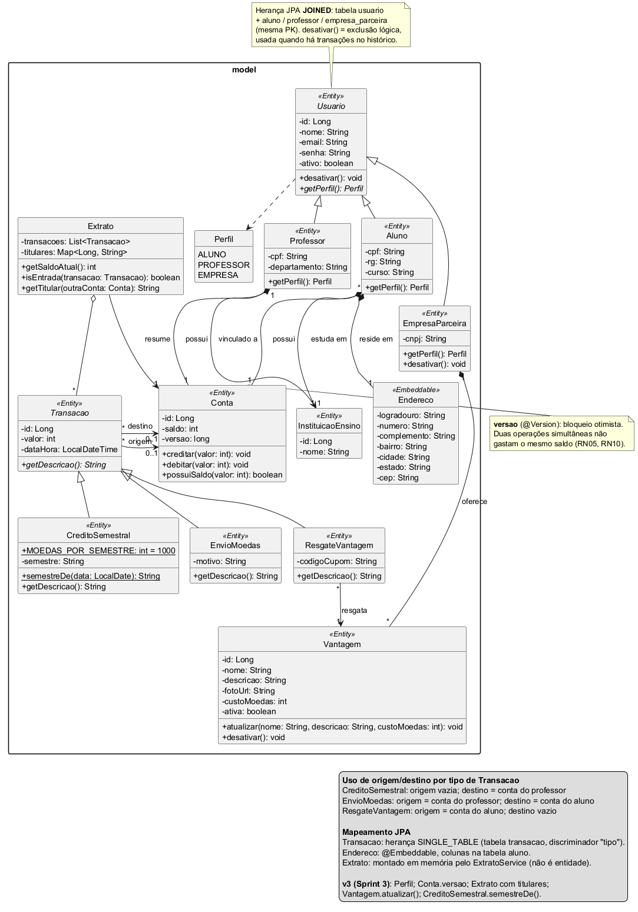

| Classe | Responsabilidade |
|---|---|
| **Usuario** (abstrata) | Concentra `id`, `nome`, `email` (login), `senha` (RN12) e `ativo` (exclusão lógica). `getPerfil()` define o que o usuário pode acessar. Base de `Aluno`, `Professor` e `EmpresaParceira`. |
| **Perfil** | Enumeração ALUNO, PROFESSOR ou EMPRESA, levada no token JWT. |
| **Aluno** | CPF, RG, curso, endereço e instituição de ensino (RN01, RN02). Possui uma `Conta`. |
| **Professor** | CPF, departamento e instituição de ensino (RN03). Possui uma `Conta`. |
| **EmpresaParceira** | CNPJ; oferece várias `Vantagem`s. |
| **InstituicaoEnsino** | Instituição pré-cadastrada à qual alunos e professores estão vinculados. |
| **Endereco** | Objeto de valor incorporado ao aluno (`@Embeddable`). |
| **Conta** | Saldo de moedas do aluno ou do professor; `creditar`, `debitar` e `possuiSaldo` garantem que o saldo nunca fique negativo. `versao` (`@Version`) impede que operações simultâneas gastem o mesmo saldo. |
| **Transacao** (abstrata) | Movimentação de moedas, com `valor`, `dataHora`, conta de origem e conta de destino. |
| **CreditoSemestral** | Crédito de 1.000 moedas ao professor em um `semestre` (RN04). |
| **EnvioMoedas** | Moedas do professor para o aluno, com `motivo` obrigatório (RN05). |
| **ResgateVantagem** | Troca de moedas do aluno por uma `Vantagem`, com `codigoCupom` único (RN10, RN11). |
| **Vantagem** | Nome, descrição, foto, custo em moedas e situação ativa/inativa (RN09). |
| **Extrato** | Objeto não persistido que reúne saldo, transações e o nome do dono de cada conta envolvida (RN08). |

### 6.2 Camadas MVC (`controller` / `security` / `service` / `repository`)

Fonte PlantUML: [`docs/sprint-03/diagrama-classes-camadas.puml`](docs/sprint-03/diagrama-classes-camadas.puml) · v2: [`sprint-02`](docs/sprint-02/diagrama-classes-camadas.puml) · v1: [`sprint-01`](docs/sprint-01/diagrama-classes-camadas.puml)

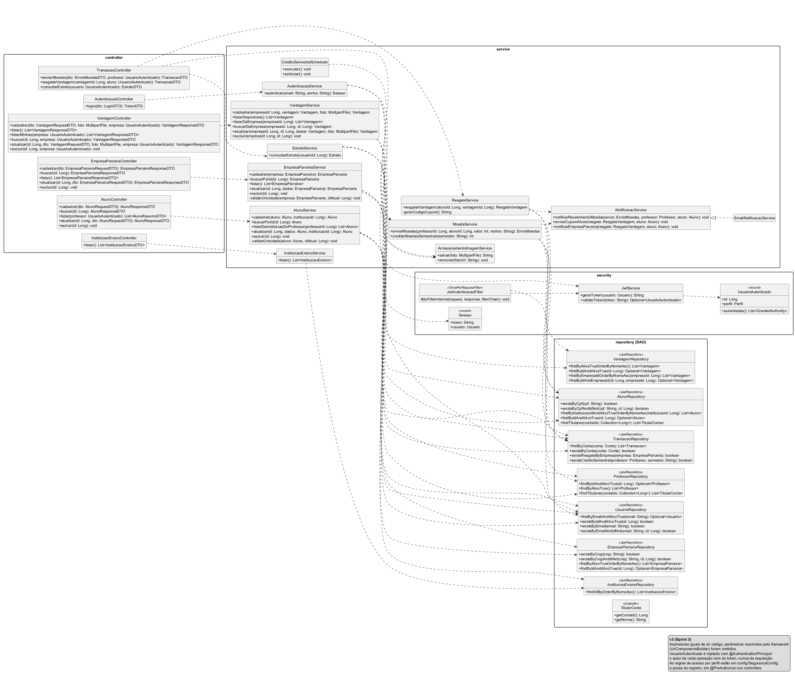

| Camada | Pacote | Responsabilidade |
|---|---|---|
| **Controller** | `controller` | Endpoints REST consumidos pelo front-end. Convertem DTOs e delegam aos services, sem regras de negócio. |
| **DTO** | `dto` | Objetos de requisição/resposta da API (`record`s) com as validações de entrada (Bean Validation). |
| **Tratamento de erros** | `exception` | `GlobalExceptionHandler` converte exceções em respostas JSON padronizadas (`ErroDTO`). |
| **Segurança** | `security` | `JwtService` emite e valida os tokens; `JwtAutenticacaoFilter` autentica cada requisição. |
| **Service** | `service` | Regras de negócio (RN01–RN12), transações, notificações, agendamento e armazenamento das fotos. |
| **Repository (DAO)** | `repository` | Interfaces Spring Data JPA de acesso ao banco, uma por agregado. |
| **Model** | `model` | Entidades JPA e objetos de domínio da seção 6.1. |
| **Configuração** | `config` | Regras de acesso (`SegurancaConfig`), `PasswordEncoder` (BCrypt), CORS, agendamento e publicação das fotos. |

### 6.3 DTOs e Tratamento de Erros

Fonte PlantUML: [`docs/sprint-03/diagrama-classes-dto.puml`](docs/sprint-03/diagrama-classes-dto.puml) · v1: [`sprint-02`](docs/sprint-02/diagrama-classes-dto.puml)

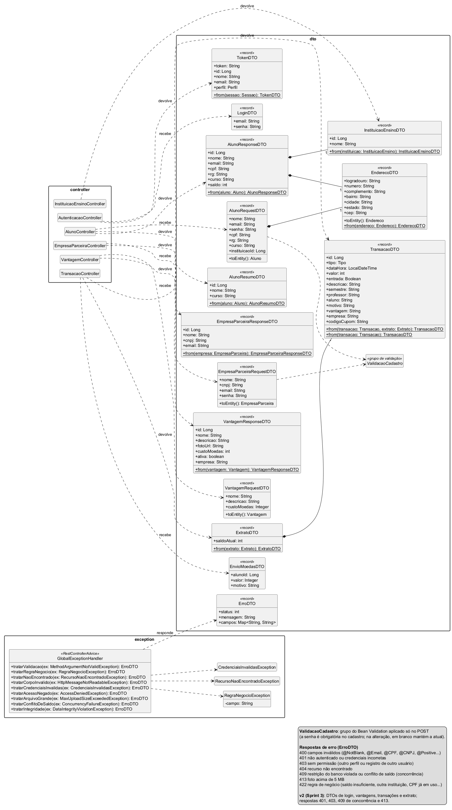

### 6.4 Services e Repositórios Utilizados

| Service | Responsabilidade | Repositórios |
|---|---|---|
| **AutenticacaoService** | Valida e-mail e senha e emite o token JWT (UC01). | `UsuarioRepository` |
| **AlunoService** | CRUD de aluno, com validação de CPF e e-mail únicos (UC02; RN01, RN02) e lista de alunos para o professor (UC13; RN06). | `AlunoRepository`, `UsuarioRepository`, `InstituicaoEnsinoRepository`, `ProfessorRepository`, `TransacaoRepository` |
| **EmpresaParceiraService** | CRUD de empresa parceira, com validação de CNPJ e e-mail únicos (UC04, UC14). | `EmpresaParceiraRepository`, `UsuarioRepository`, `TransacaoRepository` |
| **VantagemService** | Manutenção e consulta de vantagens (UC05, UC08). | `VantagemRepository`, `EmpresaParceiraRepository` |
| **ArmazenamentoImagemService** | Grava e remove as fotos em disco, conferindo se o conteúdo é JPG ou PNG (RN09, US13). | — |
| **InstituicaoEnsinoService** | Lista as instituições pré-cadastradas (UC03). | `InstituicaoEnsinoRepository` |
| **MoedaService** | Envio de moedas (UC06; RN05–RN07) e crédito semestral (UC11; RN04). | `ProfessorRepository`, `AlunoRepository`, `TransacaoRepository` |
| **ResgateService** | Resgate de vantagem e geração do código do cupom (UC09, UC12; RN10–RN11). | `AlunoRepository`, `VantagemRepository`, `TransacaoRepository` |
| **ExtratoService** | Monta o `Extrato` do usuário autenticado (UC07; RN08). | `UsuarioRepository`, `AlunoRepository`, `ProfessorRepository`, `TransacaoRepository` |
| **NotificacaoService** / **EmailNotificacaoService** | Interface e implementação SMTP dos e-mails do sistema (UC10), entregues depois do commit. | — |
| **CreditoSemestralScheduler** | Tarefa agendada que aciona `MoedaService.creditarMoedasSemestrais` todos os dias e ao iniciar; só credita quem ainda não recebeu no semestre (UC11). | — |

### 6.5 Sequência de uma requisição: Resgatar Vantagem

Exemplo de uma operação atravessando todas as camadas, da tela ao banco. Os diagramas de todos os casos de uso estão na [seção 15](#15-diagramas-de-sequência-e-visão-geral-de-interação). Fonte PlantUML: [`docs/sprint-04/diagrama-sequencia-uc09-resgatar-vantagem.puml`](docs/sprint-04/diagrama-sequencia-uc09-resgatar-vantagem.puml) · v1: [`sprint-03`](docs/sprint-03/diagrama-sequencia-resgate.puml)

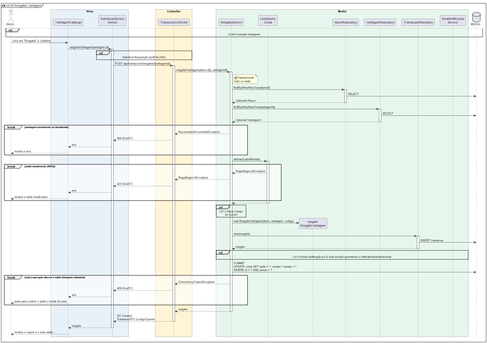

---

## 7. Diagrama de Componentes

Fonte PlantUML: [`docs/sprint-03/diagrama-componentes.puml`](docs/sprint-03/diagrama-componentes.puml) · v2: [`sprint-02`](docs/sprint-02/diagrama-componentes.puml) · v1: [`sprint-01`](docs/sprint-01/diagrama-componentes.puml)

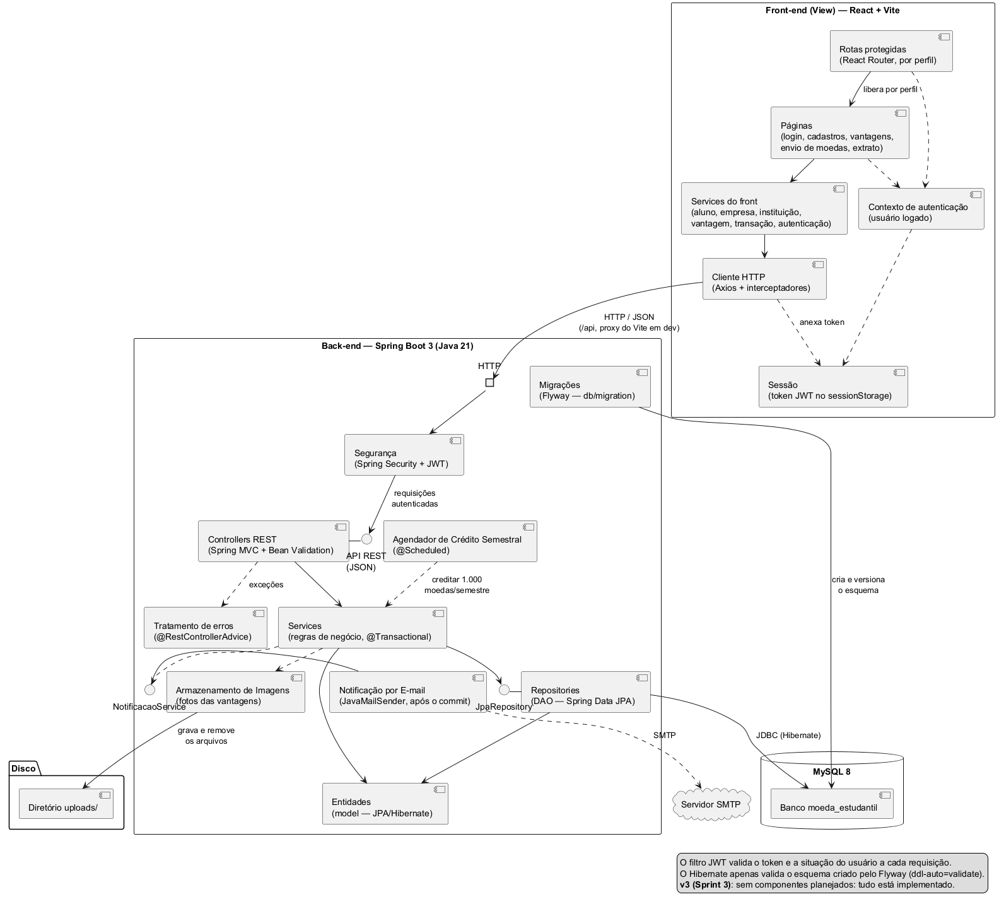

| Componente | Papel no MVC | Descrição |
|---|---|---|
| **Páginas (React)** | View | Telas de login, cadastros, vantagens, envio de moedas e extrato. |
| **Rotas protegidas (React Router)** | View | Libera cada tela conforme o perfil. É uma conveniência de navegação: quem garante as permissões é o back-end. |
| **Contexto de autenticação** | View | Disponibiliza o usuário logado para todas as telas. |
| **Services do front** | View | Uma função por endpoint (`alunoService`, `empresaService`, `instituicaoService`, `vantagemService`, `transacaoService`, `autenticacaoService`). |
| **Cliente HTTP (Axios)** | View | Chama a API REST, anexa o token JWT da sessão e leva ao login quando o token deixa de valer. |
| **Sessão** | View | Guarda o token no `sessionStorage`, separado por aba. |
| **Segurança (Spring Security + JWT)** | — | Filtro que valida o token antes de cada requisição chegar aos controllers (RN12). |
| **Controllers REST** | Controller | Expõem a API REST/JSON e delegam aos services. |
| **Services** | Model | Regras de negócio; dependem das interfaces `JpaRepository` e `NotificacaoService`, não das implementações. |
| **Tratamento de erros** | Controller | `@RestControllerAdvice` que devolve os erros em JSON, com mensagem por campo. |
| **Repositories (DAO)** | Model | Acesso ao MySQL via Spring Data JPA/Hibernate. |
| **Entidades** | Model | Classes do modelo de domínio mapeadas com JPA. |
| **Migrações (Flyway)** | — | Scripts SQL versionados que criam o esquema e a carga inicial. |
| **Notificação por E-mail** | Model | Implementa `NotificacaoService` e envia e-mails pelo servidor SMTP, depois do commit e em segundo plano. |
| **Agendador de Crédito Semestral** | Model | Executa o crédito de 1.000 moedas por semestre (RN04). |
| **Armazenamento de Imagens** | Model | Guarda as fotos das vantagens em disco; a entidade guarda apenas a URL. |
| **MySQL 8** | — | Banco de dados relacional da aplicação. |
| **Servidor SMTP** | — | Serviço externo de entrega de e-mails. |

---

## 8. Modelo ER

Fonte PlantUML: [`docs/sprint-03/modelo-er.puml`](docs/sprint-03/modelo-er.puml) · v1: [`sprint-02`](docs/sprint-02/modelo-er.puml) · Implementação: [`V1__criar_tabelas.sql`](backend/src/main/resources/db/migration/V1__criar_tabelas.sql) e [`V3__bloqueio_otimista_conta.sql`](backend/src/main/resources/db/migration/V3__bloqueio_otimista_conta.sql)

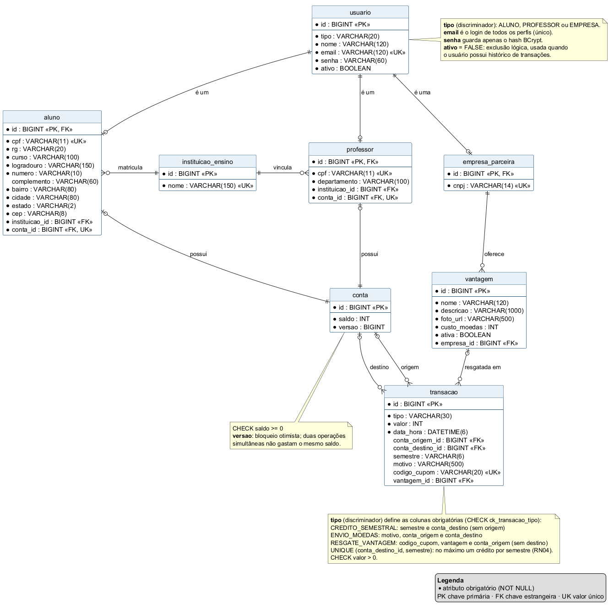

| Tabela | Origem no modelo de classes | Observações |
|---|---|---|
| `usuario` | `Usuario` (abstrata) | Dados comuns e login. `tipo` (ALUNO, PROFESSOR, EMPRESA) é o discriminador. `email` único em todos os perfis. |
| `aluno`, `professor`, `empresa_parceira` | Subclasses de `Usuario` | Mesma PK de `usuario` (PK e FK ao mesmo tempo). CPF/CNPJ únicos. |
| `aluno` (colunas de endereço) | `Endereco` (`@Embeddable`) | Objeto de valor gravado na própria tabela do aluno. |
| `instituicao_ensino` | `InstituicaoEnsino` | Pré-cadastrada pela carga inicial (RN02). |
| `conta` | `Conta` | Saldo de aluno ou professor. Referenciada por `aluno.conta_id` / `professor.conta_id` (únicos). `versao` sustenta o bloqueio otimista. |
| `vantagem` | `Vantagem` | Pertence a uma empresa parceira. |
| `transacao` | `Transacao` e subclasses | Uma tabela para os três tipos; `tipo` é o discriminador. |

**Regras garantidas pelo próprio banco** (além das validações da aplicação):

| Restrição | Regra |
|---|---|
| `UNIQUE (email)`, `UNIQUE (cpf)`, `UNIQUE (cnpj)` | RN01 e unicidade do login |
| `CHECK (saldo >= 0)` em `conta` | O saldo nunca fica negativo (RN05, RN10) |
| `CHECK (custo_moedas > 0)`, `CHECK (valor > 0)` | Custos e valores são inteiros positivos (RN05, RN09) |
| `CHECK ck_transacao_tipo` | Cada tipo de transação tem suas colunas obrigatórias (ex.: envio exige `motivo`) |
| `UNIQUE (conta_destino_id, semestre)` | No máximo um crédito semestral por professor por semestre (RN04) |
| `UNIQUE (codigo_cupom)` | Código de resgate único (RN11) |

---

## 9. Estratégia de Acesso ao Banco de Dados

A persistência combina **ORM** (JPA/Hibernate), o padrão **DAO** (repositórios Spring Data JPA) e **migrações versionadas** (Flyway):

```
Controller ──► Service ──► Repository (DAO, interface) ──► Hibernate (ORM) ──► JDBC ──► MySQL 8
                 │                                                                        ▲
         @Transactional                                     Flyway (db/migration) ────────┘
                                                            cria e versiona o esquema
```

### 9.1 ORM — JPA / Hibernate

As entidades do pacote `model` são mapeadas com anotações JPA, e o Hibernate gera o SQL de inserção, consulta, alteração e exclusão.

| Decisão de mapeamento | Motivo |
|---|---|
| `Usuario` → herança **`JOINED`** (tabela `usuario` + uma por subtipo) | Os subtipos têm muitos atributos próprios e obrigatórios (`NOT NULL` só é possível em tabelas separadas) e o `email` precisa ser único entre todos os perfis. |
| `Transacao` → herança **`SINGLE_TABLE`** (tabela `transacao`) | O extrato (RN08) lê todos os tipos juntos, ordenados por data, em uma única consulta sem junções. As colunas específicas são poucas e protegidas pelo `CHECK` por tipo. |
| `Endereco` → `@Embeddable` | Objeto de valor sem identidade própria; fica na tabela `aluno`. |
| `Conta` → `@OneToOne(cascade = ALL)` | A conta nasce e é removida junto com o aluno/professor. |
| Chaves → `GenerationType.IDENTITY` | Usa o `AUTO_INCREMENT` do MySQL. |
| Listagens com `@EntityGraph` | Instituição e conta vêm na mesma consulta (JOIN), evitando o problema N+1. |
| `default_batch_fetch_size=50` | Nas demais associações, o Hibernate agrupa as consultas em lotes (`IN (...)`), em vez de uma por registro. |
| Projeção `TitularConta` | O extrato busca apenas o nome do dono de cada conta, de uma só vez, sem carregar as entidades completas. |
| `Conta.versao` → `@Version` | Bloqueio otimista: `UPDATE ... WHERE id = ? AND versao = ?`. Quem leu um saldo antigo tem a gravação recusada. |
| `spring.jpa.open-in-view=false` | O acesso ao banco fica restrito às transações dos services. |

### 9.2 DAO — Repositórios Spring Data JPA

Cada agregado tem uma interface em `repository` que estende `JpaRepository` (CRUD pronto). As consultas específicas são **métodos derivados do nome** (`existsByCpf`, `findByAtivaTrueOrderByNomeAsc`) ou **JPQL com `@Query`** (`findByConta`, `existsCreditoSemestral`, `findTitulares`). Os services dependem apenas dessas interfaces; a implementação é gerada pelo Spring em tempo de execução.

### 9.3 Versionamento do esquema — Flyway

O esquema não é gerado pelo Hibernate: ele é criado por scripts SQL versionados em [`backend/src/main/resources/db/migration`](backend/src/main/resources/db/migration), executados automaticamente na inicialização.

| Migração | Conteúdo |
|---|---|
| `V1__criar_tabelas.sql` | Todas as tabelas, chaves e restrições do modelo ER. |
| `V2__carga_inicial.sql` | Instituições participantes e professores pré-cadastrados (RN02, RN03). |
| `V3__bloqueio_otimista_conta.sql` | Coluna `conta.versao`, usada no bloqueio otimista do saldo. |
| `db/demo/R__dados_demonstracao.sql` | Alunos, empresas e vantagens da apresentação. Migração repetível, carregada apenas no perfil `demo`. |

Com `spring.jpa.hibernate.ddl-auto=validate`, o Hibernate **confere na inicialização se as entidades batem com as tabelas** e impede a aplicação de subir se houver divergência — o que mantém o modelo de classes, o modelo ER e o código alinhados.

### 9.4 Transações, integridade e exclusão

- Os métodos dos services são `@Transactional` (consultas com `readOnly = true`). Alterações usam o *dirty checking* do Hibernate: basta alterar a entidade carregada.
- Unicidade de CPF, CNPJ e e-mail é verificada no service (mensagem amigável por campo, HTTP 422) e garantida pelo `UNIQUE` do banco (requisições concorrentes recebem HTTP 409).
- **Exclusão**: se o aluno ou a empresa não tiver movimentações, o registro é removido do banco (e pode se cadastrar de novo). Se tiver, a exclusão é **lógica** (`ativo = false`): o acesso é encerrado, mas as transações continuam nos extratos (RN08, US12); no caso da empresa, as vantagens também são desativadas.
- Senhas são gravadas apenas como hash **BCrypt** e nunca são devolvidas pela API.
- **Concorrência no saldo**: sem proteção, dois envios simultâneos leem o mesmo saldo e ambos passam. Em teste com a anotação removida, 4 envios simultâneos de 1.000 moedas foram aceitos sobre um saldo de 1.000. Com `@Version`, apenas um é aceito; os demais recebem HTTP 409 (bloqueio otimista ou *deadlock* detectado pelo MySQL) ou 422 (saldo insuficiente), e o usuário pode tentar de novo.
- **Efeitos fora do banco depois do commit**: e-mails e remoção de arquivos são agendados com `TransactionSynchronization.afterCommit`. Se a transação for desfeita, nenhum e-mail é enviado; se o e-mail falhar, a transação já está confirmada e a falha é registrada em log (US04).

---

## 10. Padrões Utilizados

### 10.1 Padrões arquiteturais

| Padrão | Onde | Como é aplicado |
|---|---|---|
| **MVC (Model-View-Controller)** | Sistema inteiro | **View**: páginas e componentes React (`frontend/src`). **Controller**: controllers REST (`controller`). **Model**: services, repositórios e entidades (`service`, `repository`, `model`). |
| **Arquitetura em camadas** | `backend` | `controller` → `service` → `repository` → `model`. Cada camada depende apenas da camada abaixo: controllers não acessam repositórios e services não conhecem DTOs, rotas nem códigos HTTP. A única exceção é o tipo `MultipartFile`, que representa a foto recebida e é passado aos services de vantagens, como previsto no modelo. |
| **Cliente-servidor com API REST** | Front-end ↔ back-end | Recursos no plural (`/api/alunos`, `/api/empresas`), verbos HTTP (`GET`, `POST`, `PUT`, `DELETE`), JSON e códigos de status com significado (201, 204, 400, 401, 403, 404, 409, 413, 422). A API não guarda estado de sessão: cada requisição leva o token JWT. |
| **Front Controller** | Spring MVC | O `DispatcherServlet` recebe todas as requisições e as encaminha ao controller e ao método corretos. |
| **Cadeia de filtros (Intercepting Filter)** | Spring Security | Toda requisição passa por `JwtAutenticacaoFilter` e pelas regras de `SegurancaConfig` antes de chegar a um controller. |

### 10.2 Padrões de persistência

| Padrão | Onde | Como é aplicado |
|---|---|---|
| **ORM (Mapeamento Objeto-Relacional)** | `model` | Entidades anotadas com JPA; o Hibernate traduz objetos e associações em tabelas, chaves e SQL. |
| **DAO / Repository** | `repository` | Uma interface por agregado (`AlunoRepository`, `EmpresaParceiraRepository`...) estendendo `JpaRepository`; o acesso a dados fica isolado das regras de negócio. |
| **Data Mapper** | Hibernate | As entidades não conhecem o banco (sem SQL nem métodos `save` próprios); o mapeador faz a ponte, ao contrário do padrão *Active Record*. |
| **Unit of Work** | Services `@Transactional` | O contexto de persistência acompanha as entidades carregadas e grava as alterações ao fim da transação (*dirty checking*), tudo ou nada. |
| **Identity Field** | Todas as entidades | Chave substituta `id` (`BIGINT AUTO_INCREMENT`, `GenerationType.IDENTITY`). |
| **Class Table Inheritance** | `Usuario` (`JOINED`) | Tabela `usuario` com os dados comuns + uma tabela por subtipo (`aluno`, `professor`, `empresa_parceira`). |
| **Single Table Inheritance** | `Transacao` (`SINGLE_TABLE`) | Os três tipos de transação em uma tabela, com a coluna discriminadora `tipo`. |
| **Embedded Value** | `Endereco` (`@Embeddable`) | Objeto de valor gravado como colunas da tabela `aluno`. |
| **Migrações versionadas** | Flyway (`db/migration`) | O esquema evolui por scripts numerados (`V1__`, `V2__`), aplicados uma única vez e registrados na tabela `flyway_schema_history`. |
| **Exclusão lógica (*soft delete*)** | `Usuario.ativo`, `Vantagem.ativa` | Registros com histórico de transações são desativados em vez de apagados, preservando os extratos. |
| **Fetch join / Entity Graph** | `AlunoRepository`, `ProfessorRepository`, `VantagemRepository` | `@EntityGraph` carrega as associações na mesma consulta, evitando o problema N+1. |
| **Optimistic Offline Lock** | `Conta.versao` (`@Version`) | Em vez de travar a linha durante a leitura, a gravação confere se a versão ainda é a mesma; se não for, a operação é recusada. |

### 10.3 Padrões de projeto no back-end

| Padrão | Onde | Como é aplicado |
|---|---|---|
| **DTO (Data Transfer Object)** | `dto` | `record`s separados para requisição (`AlunoRequestDTO`) e resposta (`AlunoResponseDTO`); a API nunca expõe as entidades nem a senha. |
| **Static Factory Method** | DTOs | Conversões nomeadas: `AlunoResponseDTO.from(aluno)` e `dto.toEntity()`. |
| **Service Layer** | `service` | Os services concentram as regras de negócio (RN01, RN02...), as validações de unicidade e as transações. |
| **Injeção de Dependências / Inversão de Controle** | Todo o back-end | O Spring cria e injeta os objetos pelo construtor; os services dependem de interfaces (`JpaRepository`, `PasswordEncoder`) e não de implementações. |
| **Strategy** | `PasswordEncoder`, `NotificacaoService` | O algoritmo de hash e o canal de notificação são interfaces com implementação trocável (`BCryptPasswordEncoder`, `EmailNotificacaoService`). |
| **Tratamento centralizado de exceções** | `GlobalExceptionHandler` (`@RestControllerAdvice`) | Todas as exceções viram respostas JSON no formato único `ErroDTO`, com mensagem por campo. |
| **Modelo de domínio rico (GRASP Especialista)** | `Conta`, `EmpresaParceira` | Quem tem a informação aplica a regra: `Conta.debitar()` impede saldo negativo; `EmpresaParceira.desativar()` desativa as próprias vantagens. |
| **Herança e polimorfismo** | `Usuario`, `Transacao` | Subtipos especializam a classe abstrata; `Usuario.getPerfil()` e `Transacao.getDescricao()` são implementados por cada subtipo. |
| **Grupos de validação** | `ValidacaoCadastro` | A mesma classe de DTO é validada de forma diferente no cadastro (senha obrigatória) e na alteração (senha opcional). |
| **Autorização declarativa** | `SegurancaConfig`, `@PreAuthorize` | As permissões ficam declaradas fora das regras de negócio: por perfil na configuração e por posse do registro nos controllers. |

### 10.4 Padrões no front-end

| Padrão | Onde | Como é aplicado |
|---|---|---|
| **SPA (Single Page Application)** | React Router | Rotas declarativas aninhadas em um `Layout` comum (`<Outlet />`), sem recarregar a página. |
| **Componentização** | `components/` | Componentes reutilizáveis (`Layout`, `Campo`, `Alerta`, `RotaProtegida`) compostos pelas páginas. |
| **Camada de serviços (cliente da API)** | `services/` | Uma instância única do Axios (`api.js`) e um módulo por recurso (`alunoService`, `vantagemService`...); as páginas nunca chamam o Axios diretamente. |
| **Interceptadores** | `services/api.js` | Anexam o token a toda requisição e encerram a sessão quando a API responde 401, em um único lugar. |
| **Context API** | `contexts/AutenticacaoContext.jsx` | O usuário logado fica disponível para qualquer tela, sem passar propriedades por toda a árvore. |
| **Componentes controlados** | Formulários | O estado do React é a fonte única dos valores dos campos, o que permite aplicar as máscaras a cada digitação. |
| **Custom Hook** | `hooks/useMensagemFlash.js`, `useAutenticacao` | Lógica de mensagem pós-navegação e de acesso à sessão reutilizada pelas telas. |

### 10.5 Convenções de código e de banco

- **Idioma**: nomes do domínio em português (classes, métodos, tabelas e rotas), seguindo o vocabulário do enunciado.
- **Java**: classes em `PascalCase`, métodos e atributos em `camelCase`, constantes em `MAIUSCULAS_COM_SUBLINHADO`; pacotes organizados por camada.
- **Banco**: tabelas e colunas em `snake_case` e no singular; restrições nomeadas com prefixo do tipo (`pk_`, `fk_`, `uk_`, `ck_`, `ix_`).
- **Migrações**: `V{versão}__{descricao}.sql`; uma migração aplicada nunca é alterada, toda mudança gera uma nova versão.
- **REST**: recursos no plural sob `/api`; `POST` responde `201 Created` com o cabeçalho `Location`; `DELETE` responde `204 No Content`.
- **Testes**: o nome do método descreve o comportamento esperado (ex.: `cadastrarComCpfDuplicadoRetorna422`).

---

## 11. API REST

Base: `http://localhost:8080/api`. Corpo das requisições e respostas em JSON, exceto nas vantagens, que usam `multipart/form-data` por causa da foto. Rotas protegidas exigem o cabeçalho `Authorization: Bearer <token>`, obtido no login.

| Método | Rota | Quem acessa | Descrição | Respostas |
|---|---|---|---|---|
| `POST` | `/auth/login` | Público | Autentica e devolve o token JWT e os dados do usuário (UC01) | 200 · 400 · 401 |
| `GET` | `/instituicoes` | Público | Lista as instituições pré-cadastradas (UC03) | 200 |
| `GET` | `/fotos/{arquivo}` | Público | Foto de uma vantagem | 200 · 404 |
| `POST` | `/alunos` | Público | Cadastra aluno (UC02) | 201 · 400 · 422 |
| `GET` | `/alunos` | Professor | Lista os alunos da instituição do professor, sem dados pessoais (UC13) | 200 |
| `GET` | `/alunos/{id}` | O próprio aluno | Consulta o cadastro | 200 · 403 |
| `PUT` | `/alunos/{id}` | O próprio aluno | Altera o cadastro (senha em branco mantém a atual) | 200 · 400 · 403 · 422 |
| `DELETE` | `/alunos/{id}` | O próprio aluno | Exclui a conta e encerra o acesso | 204 · 403 |
| `POST` | `/empresas` | Público | Cadastra empresa parceira (UC04) | 201 · 400 · 422 |
| `GET` | `/empresas` | Autenticado | Lista as empresas parceiras ativas (UC14) | 200 |
| `GET` | `/empresas/{id}` | A própria empresa | Consulta o cadastro | 200 · 403 |
| `PUT` | `/empresas/{id}` | A própria empresa | Altera o cadastro | 200 · 400 · 403 · 422 |
| `DELETE` | `/empresas/{id}` | A própria empresa | Exclui a empresa e encerra o acesso | 204 · 403 |
| `GET` | `/vantagens` | Autenticado | Catálogo de vantagens ativas (UC08) | 200 |
| `GET` | `/vantagens/minhas` | Empresa | Vantagens da empresa, inclusive as desativadas (UC05) | 200 |
| `GET` | `/vantagens/{id}` | Empresa | Consulta uma vantagem da própria empresa | 200 · 404 |
| `POST` | `/vantagens` | Empresa | Cadastra vantagem: partes `dados` (JSON) e `foto` (JPG ou PNG, até 5 MB) | 201 · 400 · 413 · 422 |
| `PUT` | `/vantagens/{id}` | Empresa | Altera vantagem; sem a parte `foto`, mantém a atual | 200 · 400 · 404 · 413 · 422 |
| `DELETE` | `/vantagens/{id}` | Empresa | Desativa a vantagem | 204 · 404 |
| `POST` | `/transacoes/envios` | Professor | Envia moedas a um aluno e o notifica (UC06) | 201 · 400 · 409 · 422 |
| `POST` | `/transacoes/resgates/{vantagemId}` | Aluno | Resgata uma vantagem, gera o cupom e envia os e-mails (UC09) | 201 · 404 · 409 · 422 |
| `GET` | `/transacoes/extrato` | Aluno, Professor | Saldo e transações do usuário autenticado (UC07) | 200 |

Sem token válido, as rotas protegidas respondem **401**; com um perfil sem permissão, **403**. O usuário de cada operação vem sempre do token, nunca de um campo da requisição.

Exemplo de login:

```json
POST /api/auth/login
{ "email": "ana.souza@pucminas.br", "senha": "professor123" }

200 OK
{ "token": "eyJhbGciOi...", "id": 1, "nome": "Ana Paula Souza", "email": "ana.souza@pucminas.br", "perfil": "PROFESSOR" }
```

Exemplo de cadastro de aluno (CPF, CNPJ e CEP são aceitos com ou sem máscara e armazenados só com dígitos):

```json
POST /api/alunos
{
  "nome": "Joana Silva",
  "email": "joana@email.com",
  "senha": "segredo123",
  "cpf": "123.456.789-09",
  "rg": "MG-12.345.678",
  "curso": "Engenharia de Software",
  "instituicaoId": 1,
  "endereco": {
    "logradouro": "Rua Dom José Gaspar", "numero": "500", "complemento": "Prédio 34",
    "bairro": "Coração Eucarístico", "cidade": "Belo Horizonte", "estado": "MG", "cep": "30535-901"
  }
}
```

Formato padrão dos erros, usado pelo front-end para exibir a mensagem ao lado de cada campo:

```json
{ "status": 422, "mensagem": "Já existe um aluno cadastrado com este CPF.", "campos": { "cpf": "Já existe um aluno cadastrado com este CPF." } }
```

---

## 12. Como Executar

**Pré-requisitos:** JDK 21 ou superior, Node.js 20.19+ (ou 22.12+) e, opcionalmente, MySQL 8. O Maven não precisa estar instalado (o projeto usa o Maven Wrapper).

### Back-end (`backend/`)

Com **MySQL** (padrão) — o banco `moeda_estudantil` é criado automaticamente e as migrações rodam na inicialização:

```powershell
cd backend
$env:DB_USERNAME="root"; $env:DB_PASSWORD="sua-senha"   # PowerShell
.\mvnw spring-boot:run
```

Sem MySQL, com **H2 em memória** (dados perdidos ao encerrar):

```powershell
cd backend
.\mvnw spring-boot:run "-Dspring-boot.run.profiles=h2"
```

Para a **apresentação**, acrescente o perfil `demo`, que carrega alunos, empresas e vantagens prontos (veja a [tabela abaixo](#dados-da-carga-inicial)):

```powershell
cd backend
.\mvnw spring-boot:run "-Dspring-boot.run.profiles=h2,demo"
```

A API sobe em `http://localhost:8080/api`. No perfil `h2`, o console do banco fica em `http://localhost:8080/h2-console` (JDBC URL `jdbc:h2:mem:moeda_estudantil`, usuário `sa`, sem senha).

Testes automatizados (persistência, API, segurança, concorrência e e-mail, executados sobre o H2):

```powershell
cd backend
.\mvnw test
```

| Variável de ambiente | Padrão | Uso |
|---|---|---|
| `DB_URL` | `jdbc:mysql://localhost:3306/moeda_estudantil?createDatabaseIfNotExist=true&serverTimezone=America/Sao_Paulo` | URL JDBC do MySQL |
| `DB_USERNAME` / `DB_PASSWORD` | `root` / `root` | Credenciais do MySQL |
| `PORT` | `8080` | Porta da API |
| `CORS_ORIGINS` | `http://localhost:5173` | Origens autorizadas a chamar a API |
| `JWT_SECRET` | *(chave aleatória a cada inicialização)* | Segredo de assinatura dos tokens, com ao menos 32 caracteres. Sem ele, os logins são perdidos ao reiniciar a API. |
| `JWT_EXPIRACAO_MINUTOS` | `120` | Validade do token |
| `UPLOAD_DIR` | `uploads` | Diretório das fotos das vantagens |
| `CREDITO_SEMESTRAL_CRON` | `0 5 0 * * *` | Horário da verificação diária do crédito semestral |
| `SPRING_MAIL_HOST`, `SPRING_MAIL_PORT`, `SPRING_MAIL_USERNAME`, `SPRING_MAIL_PASSWORD` | *(sem SMTP)* | Servidor de e-mail. Sem `SPRING_MAIL_HOST`, os e-mails são escritos no log da API. |
| `MAIL_SMTP_AUTH`, `MAIL_SMTP_STARTTLS` | `false` | Autenticação e TLS do SMTP |
| `MAIL_FROM` | `nao-responda@moedaestudantil.pucminas.br` | Remetente dos e-mails |

### E-mails

Sem nenhuma configuração, o sistema funciona normalmente e **escreve cada e-mail no log da API**, o que basta para conferir os códigos de cupom. Para enviar de verdade pelo Gmail, gere uma [senha de app](https://myaccount.google.com/apppasswords) e defina:

```powershell
$env:SPRING_MAIL_HOST="smtp.gmail.com"; $env:SPRING_MAIL_PORT="587"
$env:SPRING_MAIL_USERNAME="seu-email@gmail.com"; $env:SPRING_MAIL_PASSWORD="senha-de-app"
$env:MAIL_SMTP_AUTH="true"; $env:MAIL_SMTP_STARTTLS="true"; $env:MAIL_FROM="seu-email@gmail.com"
```

### Front-end (`frontend/`)

```powershell
cd frontend
npm install
npm run dev
```

Acesse `http://localhost:5173`. Em desenvolvimento, o Vite repassa as chamadas a `/api` para o back-end em `localhost:8080`; para apontar para outra URL, defina `VITE_API_URL` (veja [`frontend/.env.example`](frontend/.env.example)).

### Dados da carga inicial

| Instituições | Professores (senha inicial `professor123`) |
|---|---|
| PUC Minas, UFMG, CEFET-MG | `ana.souza@pucminas.br`, `carlos.lima@pucminas.br`, `beatriz.rocha@ufmg.br`, `marcos.teixeira@cefetmg.br` |

Os professores recebem as 1.000 moedas do semestre logo que a API inicia.

**Perfil `demo`** (senha de todos: `demo123`):

| Perfil | Login | Observação |
|---|---|---|
| Aluno | `joana.silva@aluno.pucminas.br` | PUC Minas |
| Aluno | `pedro.santos@aluno.pucminas.br` | PUC Minas |
| Aluno | `lucas.almeida@aluno.ufmg.br` | UFMG: não aparece para professores da PUC Minas (RN06) |
| Empresa | `contato@cantinacentral.com.br` | Almoço (30) e café da manhã (15) |
| Empresa | `contato@livrariauniversitaria.com.br` | Livros técnicos (120) e kit de materiais (80) |
| Empresa | `contato@fundacaoparceira.org.br` | Desconto na mensalidade (500) |

> Como o token fica no `sessionStorage`, cada **janela anônima ou perfil do navegador**, e também cada aba aberta do zero, pode ter um login diferente: útil para mostrar o professor e o aluno lado a lado.

---

## 13. Estrutura do Repositório

```
.
├── README.md
├── backend/                                  # API REST — Spring Boot (Controller + Model)
│   ├── pom.xml, mvnw, mvnw.cmd
│   └── src/
│       ├── main/java/br/pucminas/moedaestudantil/
│       │   ├── controller/                   # Autenticação, Aluno, EmpresaParceira, InstituicaoEnsino, Vantagem, Transacao
│       │   ├── dto/                          # records de requisição/resposta e ErroDTO
│       │   ├── security/                     # JwtService, JwtAutenticacaoFilter, UsuarioAutenticado, Sessao
│       │   ├── service/                      # regras de negócio, e-mail, agendamento e fotos
│       │   ├── repository/                   # DAO — interfaces Spring Data JPA
│       │   ├── model/                        # entidades JPA, Perfil e Extrato
│       │   ├── exception/                    # exceções e GlobalExceptionHandler
│       │   └── config/                       # regras de acesso, BCrypt, CORS, agendamento e fotos
│       ├── main/resources/
│       │   ├── application.properties        # MySQL (padrão)
│       │   ├── application-h2.properties     # perfil h2
│       │   ├── application-demo.properties   # perfil demo
│       │   ├── db/migration/                 # V1 (esquema), V2 (carga inicial) e V3 (bloqueio otimista) — Flyway
│       │   ├── db/demo/                      # dados da apresentação (perfil demo)
│       │   └── fotos-demo/                   # fotos das vantagens da apresentação
│       └── test/                             # testes de persistência, API, segurança, concorrência e e-mail
├── frontend/                                 # View — React + Vite
│   └── src/
│       ├── pages/                            # Início, Login, alunos/, empresas/, vantagens/, moedas/, extrato/
│       ├── components/                       # Layout, Campo, Alerta, RotaProtegida
│       ├── contexts/                         # usuário logado (AutenticacaoContext)
│       ├── services/                         # Axios, sessão e um service por recurso da API
│       ├── hooks/, utils/                    # mensagem pós-navegação, máscaras de CPF/CNPJ/CEP
└── docs/
    ├── sprint-01/                            # modelos v1
    │   ├── casos-de-uso.puml / .png / .pdf
    │   ├── diagrama-classes.puml / .png / .pdf
    │   ├── diagrama-classes-camadas.puml / .png / .pdf
    │   └── diagrama-componentes.puml / .png / .pdf
    ├── sprint-02/                            # modelos v2 + modelo ER
    │   ├── modelo-er.puml / .png / .pdf
    │   ├── diagrama-classes.puml / .png / .pdf
    │   ├── diagrama-classes-camadas.puml / .png / .pdf
    │   ├── diagrama-classes-dto.puml / .png / .pdf
    │   └── diagrama-componentes.puml / .png / .pdf
    ├── sprint-03/                            # versão final da Release 01, alinhada ao código
    │   ├── casos-de-uso.puml / .png / .pdf                # casos de uso (v2)
    │   ├── modelo-er.puml / .png / .pdf                   # modelo ER (v2)
    │   ├── diagrama-classes.puml / .png / .pdf            # modelo de domínio (v3)
    │   ├── diagrama-classes-camadas.puml / .png / .pdf    # controller / security / service / repository (v3)
    │   ├── diagrama-classes-dto.puml / .png / .pdf        # DTOs e tratamento de erros (v2)
    │   ├── diagrama-componentes.puml / .png / .pdf        # componentes (v3)
    │   ├── diagrama-sequencia-resgate.puml / .png / .pdf  # sequência de uma requisição (v1)
    │   └── telas/                                         # capturas do protótipo em execução
    └── sprint-04/                            # Lab04S01: modelos de interação
        ├── diagrama-visao-geral-interacao.puml / .png / .pdf    # visão geral de interação
        ├── diagrama-sequencia-autenticar-requisicao.puml / ...  # interação compartilhada (ref)
        ├── diagrama-sequencia-uc01-realizar-login.puml / ...    # um diagrama por caso de uso (UC01 a UC14)
        └── estilo-sequencia.iuml                                # estilo comum aos diagramas de sequência
```

Cada sprint tem sua própria pasta em `docs/`, preservando todas as versões dos modelos UML, conforme exigido no enunciado. Cada diagrama tem a fonte PlantUML (`.puml`), a imagem (`.png`) e uma versão em PDF vetorial (`.pdf`). Para regerar as imagens a partir das fontes:

```
java -DPLANTUML_LIMIT_SIZE=16384 -jar plantuml.jar -charset UTF-8 -tpng docs/sprint-03/*.puml docs/sprint-04/*.puml
```

> Os PDFs foram gerados a partir da exportação SVG do PlantUML (`-tsvg`) e impressos via navegador, pois a exportação `-tpdf` exige bibliotecas adicionais (Apache Batik/FOP).

---

## 14. Andamento das Sprints

| Sprint | Entregas | Status |
|---|---|---|
| **Lab03S01** | Diagrama de Casos de Uso, Histórias de Usuário, Diagrama de Classes e Diagrama de Componentes | ✅ Entregue |
| **Lab03S02** | Modelo ER, estratégia de acesso ao banco (ORM/DAO), CRUDs de aluno e empresa parceira (versão inicial: front-end e comunicação com back-end) | ✅ Entregue |
| **Lab03S03** | CRUDs de aluno e empresa parceira (versão final), apresentação da arquitetura e da camada de persistência (slides) | ✅ Entregue |
| **Lab04S01** | Diagramas de Sequência, Diagrama de Visão Geral de Interação e implementação dos casos de uso restantes | ✅ Entregue |

### Entregas da Lab04S01

- **Diagramas de Sequência**: um por caso de uso (UC01 a UC14), mais a interação compartilhada Autenticar Requisição ([seção 15](#15-diagramas-de-sequência-e-visão-geral-de-interação)).
- **Diagrama de Visão Geral de Interação**: encadeia as interações do sistema, do cadastro e login até as operações de cada perfil.
- **Casos de uso restantes**: nenhum ficou pendente. O protótipo completo foi construído na Release 01, à frente do cronograma, então esta sprint auditou os 14 casos de uso em relação ao código, sem precisar alterá-lo:

| Caso de uso | Back-end | Tela | Testes automatizados |
|---|---|---|---|
| UC01 Realizar Login | `AutenticacaoController`, `AutenticacaoService` | `Login` | `AutenticacaoControllerTest` |
| UC02 Manter Cadastro de Aluno | `AlunoController`, `AlunoService` | `AlunoForm`, `AlunoPerfil` | `AlunoControllerTest`, `PersistenciaTest` |
| UC03 Consultar Instituições de Ensino | `InstituicaoEnsinoController`, `InstituicaoEnsinoService` | `AlunoForm` | `InstituicaoEnsinoControllerTest` |
| UC04 Manter Cadastro de Empresa Parceira | `EmpresaParceiraController`, `EmpresaParceiraService` | `EmpresaForm`, `EmpresaPerfil` | `EmpresaParceiraControllerTest` |
| UC05 Manter Vantagens | `VantagemController`, `VantagemService`, `ArmazenamentoImagemService` | `VantagemLista`, `VantagemForm` | `VantagemControllerTest` |
| UC06 Enviar Moedas | `TransacaoController`, `MoedaService` | `EnvioMoedasForm` | `TransacaoControllerTest`, `ConcorrenciaSaldoTest` |
| UC07 Consultar Extrato | `TransacaoController`, `ExtratoService` | `Extrato` | `TransacaoControllerTest` |
| UC08 Consultar Vantagens | `VantagemController`, `VantagemService` | `VantagemCatalogo` | `VantagemControllerTest` |
| UC09 Resgatar Vantagem | `TransacaoController`, `ResgateService` | `VantagemCatalogo` | `TransacaoControllerTest` |
| UC10 Enviar Notificação por E-mail | `EmailNotificacaoService` | — | `NotificacaoEmailTest` |
| UC11 Creditar Moedas Semestrais | `CreditoSemestralScheduler`, `MoedaService` | — | `CreditoSemestralTest` |
| UC12 Gerar Código de Cupom | `ResgateService` | `VantagemCatalogo`, `Extrato` | `TransacaoControllerTest` |
| UC13 Consultar Alunos da Instituição | `AlunoController`, `AlunoService` | `AlunoLista`, `EnvioMoedasForm` | `AlunoControllerTest` |
| UC14 Consultar Empresas Parceiras | `EmpresaParceiraController`, `EmpresaParceiraService` | `EmpresaLista` | `EmpresaParceiraControllerTest` |

**Validação realizada:** os 83 testes automatizados passaram e o front-end compilou sem erros. A API também foi executada de verdade (H2 com o perfil `demo`) e percorrida por HTTP, com 49 verificações que cobrem os 14 casos de uso, incluindo caminhos de erro e os e-mails registrados no log.

### Entregas da Sprint 3

- **CRUDs de aluno e empresa parceira (versão final)**: login com JWT, cada usuário acessa apenas os próprios dados (US03, US12), telas "Meu cadastro" e "Minha empresa", e a exclusão encerra o acesso imediatamente.
- **Protótipo completo, atendendo a todos os requisitos do enunciado**:

| Requisito | Onde está |
|---|---|
| Login e senha para os três perfis (RN12) | `AutenticacaoController`, `SegurancaConfig`, `JwtAutenticacaoFilter` |
| Crédito de 1.000 moedas por semestre, acumulável (RN04) | `CreditoSemestralScheduler`, `MoedaService` |
| Envio de moedas com saldo, aluno e motivo obrigatório (RN05, RN06) | `TransacaoController`, `MoedaService`, tela "Enviar moedas" |
| E-mail ao aluno ao receber moedas (RN07) | `EmailNotificacaoService` |
| Extrato de professores e alunos (RN08) | `ExtratoService`, tela "Extrato" |
| Vantagens com descrição, foto e custo (RN09) | `VantagemController`, `ArmazenamentoImagemService`, tela "Minhas vantagens" |
| Resgate com débito do saldo (RN10) | `ResgateService`, tela "Vantagens" |
| Cupom com código único, enviado ao aluno e ao parceiro (RN11) | `ResgateService`, `EmailNotificacaoService` |

- **Modelos atualizados**: `docs/sprint-03` traz a versão final de todos os diagramas, sem nenhum elemento `<<planejado>>`, além de um novo diagrama de sequência.
- **Apresentação**: slides da arquitetura, da camada de persistência e do tutorial das tecnologias, com o roteiro de 20 minutos nas notas de cada slide.
- **Testes automatizados**: 83 testes (persistência, API, segurança, concorrência e e-mail).

**Validação realizada:** além dos testes automatizados (H2), o sistema foi executado sobre **MySQL 8**, com um **servidor SMTP real** e o **navegador**, percorrendo os fluxos dos três perfis, os caminhos de erro e envios e resgates simultâneos.

### Telas do protótipo

| Catálogo e resgate (aluno) | Extrato (aluno) |
|---|---|
| 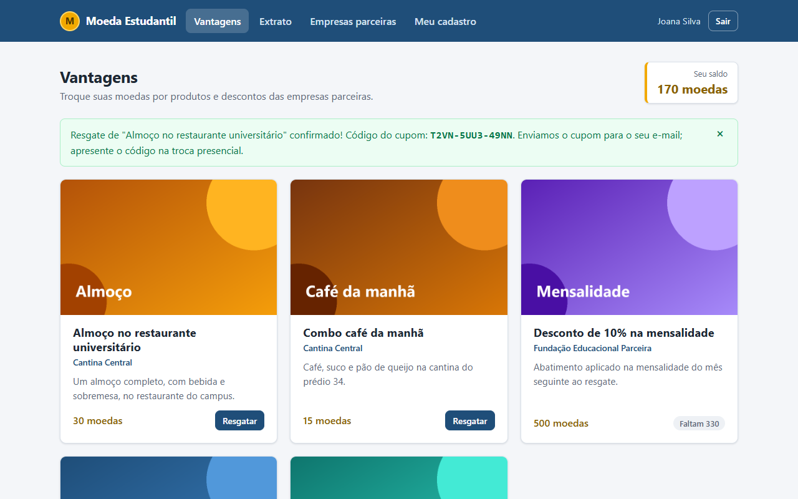 | 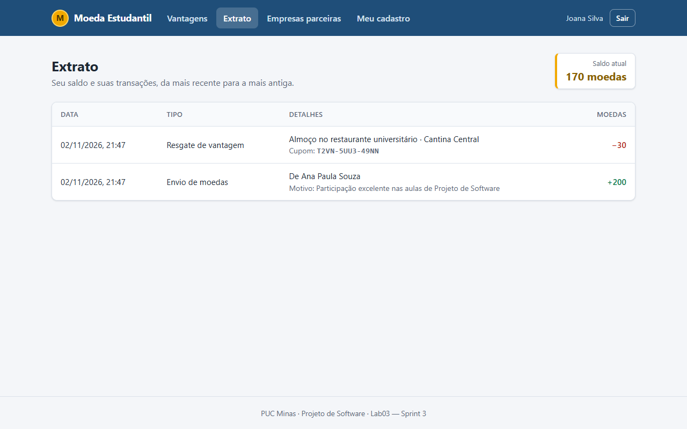 |

| Envio de moedas (professor) | Minhas vantagens (empresa) |
|---|---|
| 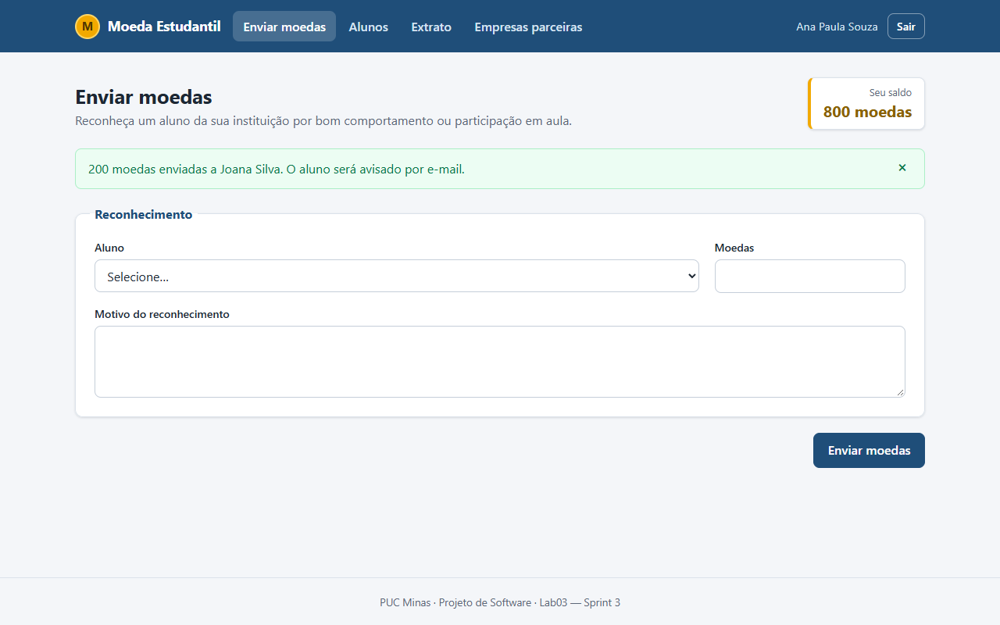 | 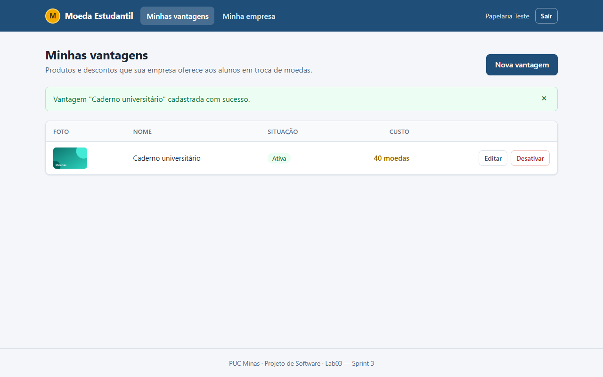 |

### Entregas da Sprint 2

- **Modelo ER** ([seção 8](#8-modelo-er)) implementado pelas migrações Flyway.
- **Estratégia de acesso ao banco** ([seção 9](#9-estratégia-de-acesso-ao-banco-de-dados)): JPA/Hibernate + repositórios DAO, aplicada a todas as entidades do modelo de domínio.
- **Padrões arquiteturais, de persistência e de projeto** documentados na [seção 10](#10-padrões-utilizados).
- **CRUD de aluno e CRUD de empresa parceira**: API REST ([seção 11](#11-api-rest)) e telas React de listagem, cadastro, edição e exclusão, com validação no back-end e mensagens de erro por campo.
- **Testes automatizados**: 23 testes (persistência sobre o esquema do Flyway e endpoints dos CRUDs).

### Histórico de versões dos modelos

| Modelo | Sprint 1 | Sprint 2 | Sprint 3 | Mudanças mais recentes |
|---|---|---|---|---|
| Casos de Uso | [v1](docs/sprint-01/casos-de-uso.puml) | — | [v2](docs/sprint-03/casos-de-uso.puml) | UC13 (Consultar Alunos da Instituição) e UC14 (Consultar Empresas Parceiras). |
| Classes — domínio | [v1](docs/sprint-01/diagrama-classes.puml) | [v2](docs/sprint-02/diagrama-classes.puml) | [v3](docs/sprint-03/diagrama-classes.puml) | `Perfil` e `getPerfil()`; `Conta.versao`; `Extrato` com os titulares das contas; `Vantagem.atualizar()`; `CreditoSemestral.semestreDe()`. |
| Classes — camadas | [v1](docs/sprint-01/diagrama-classes-camadas.puml) | [v2](docs/sprint-02/diagrama-classes-camadas.puml) | [v3](docs/sprint-03/diagrama-classes-camadas.puml) | Classes `<<planejado>>` implementadas; pacote `security`; `ArmazenamentoImagemService`. `NotificacaoService` passou a receber professor e aluno, pois a transação guarda apenas as contas. `autenticar` devolve uma `Sessao` (token e usuário), usada pelo front-end. |
| Classes — DTOs | — | [v1](docs/sprint-02/diagrama-classes-dto.puml) | [v2](docs/sprint-03/diagrama-classes-dto.puml) | DTOs de login, vantagens, transações e extrato; respostas 401, 403, 409 e 413. |
| Componentes | [v1](docs/sprint-01/diagrama-componentes.puml) | [v2](docs/sprint-02/diagrama-componentes.puml) | [v3](docs/sprint-03/diagrama-componentes.puml) | Componentes planejados implementados; rotas protegidas e contexto de autenticação no front-end; diretório de fotos em disco. |
| Modelo ER | — | [v1](docs/sprint-02/modelo-er.puml) | [v2](docs/sprint-03/modelo-er.puml) | Coluna `conta.versao`. |
| Sequência (Resgatar Vantagem) | — | — | [v1](docs/sprint-03/diagrama-sequencia-resgate.puml) | [v2 na Lab04S01](docs/sprint-04/diagrama-sequencia-uc09-resgatar-vantagem.puml): o `COMMIT` passa a ocorrer antes do retorno ao controller, os e-mails são detalhados no UC10 e cada repositório e entidade tem a sua linha de vida. |
| Sequência (demais casos de uso) | — | — | — | Novos na Lab04S01: [`docs/sprint-04`](docs/sprint-04/). |
| Visão Geral de Interação | — | — | — | Novo na Lab04S01: [v1](docs/sprint-04/diagrama-visao-geral-interacao.puml). |

---

## 15. Diagramas de Sequência e Visão Geral de Interação

Modelos da Lab04S01, em [`docs/sprint-04`](docs/sprint-04/). Cada diagrama tem a fonte PlantUML (`.puml`), a imagem (`.png`) e o PDF vetorial (`.pdf`).

**Notação UML 2:** cada diagrama é um quadro `sd`; seta cheia é mensagem síncrona, seta tracejada é retorno e seta aberta é mensagem assíncrona. Os fragmentos usados são `alt`, `opt`, `loop`, `par`, `break` (fluxo de erro, que substitui o restante da interação) e `ref` (interação definida em outro diagrama). As linhas de vida são agrupadas pelas camadas MVC e usam os nomes reais das classes e dos métodos.

### 15.1 Visão Geral de Interação

Mostra como as interações se encadeiam: cada quadro `ref` é um dos diagramas de sequência abaixo. O crédito semestral (UC11) corre em paralelo às sessões dos usuários, pois é disparado pelo tempo. Fonte PlantUML: [`docs/sprint-04/diagrama-visao-geral-interacao.puml`](docs/sprint-04/diagrama-visao-geral-interacao.puml)

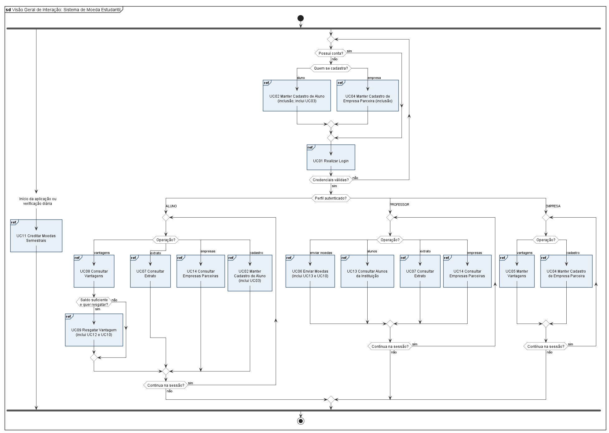

> O PlantUML não tem um tipo próprio para este diagrama, por isso a notação da UML (nós de controle e quadros `ref`) foi composta com a sintaxe de atividades.

### 15.2 Interação compartilhada: Autenticar Requisição

Referenciada por todas as rotas protegidas: validação do token JWT, conferência de que o usuário continua ativo e regras de acesso por perfil (RN12). Fonte PlantUML: [`docs/sprint-04/diagrama-sequencia-autenticar-requisicao.puml`](docs/sprint-04/diagrama-sequencia-autenticar-requisicao.puml)

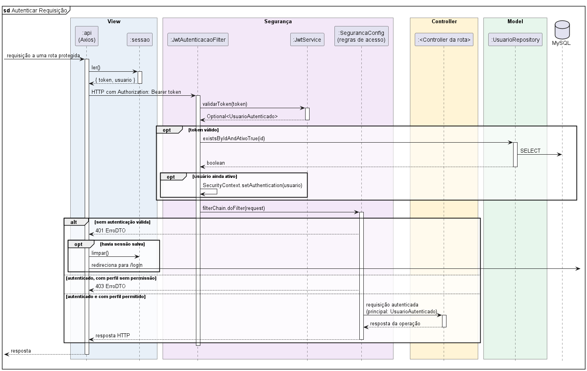

### 15.3 Diagramas de Sequência por caso de uso

<details>
<summary><strong>UC01</strong> Realizar Login</summary>

Fonte: [`.puml`](docs/sprint-04/diagrama-sequencia-uc01-realizar-login.puml) · [`.pdf`](docs/sprint-04/diagrama-sequencia-uc01-realizar-login.pdf)

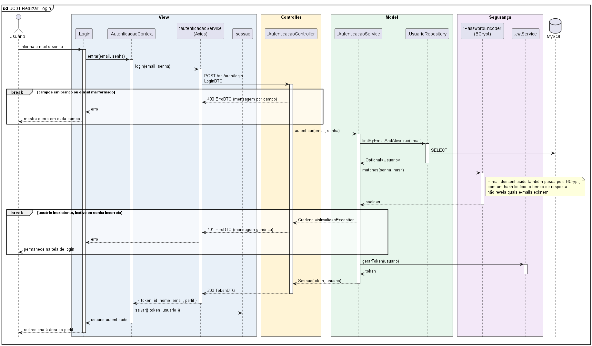
</details>

<details>
<summary><strong>UC02</strong> Manter Cadastro de Aluno</summary>

Fonte: [`.puml`](docs/sprint-04/diagrama-sequencia-uc02-manter-cadastro-aluno.puml) · [`.pdf`](docs/sprint-04/diagrama-sequencia-uc02-manter-cadastro-aluno.pdf)

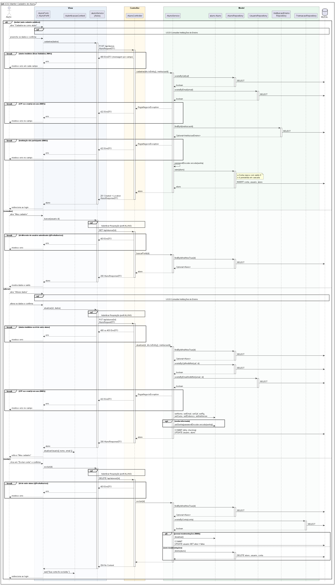
</details>

<details>
<summary><strong>UC03</strong> Consultar Instituições de Ensino</summary>

Fonte: [`.puml`](docs/sprint-04/diagrama-sequencia-uc03-consultar-instituicoes.puml) · [`.pdf`](docs/sprint-04/diagrama-sequencia-uc03-consultar-instituicoes.pdf)

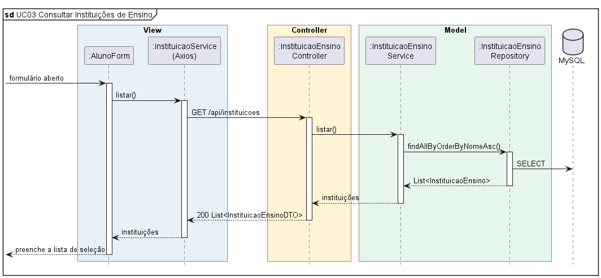
</details>

<details>
<summary><strong>UC04</strong> Manter Cadastro de Empresa Parceira</summary>

Fonte: [`.puml`](docs/sprint-04/diagrama-sequencia-uc04-manter-cadastro-empresa.puml) · [`.pdf`](docs/sprint-04/diagrama-sequencia-uc04-manter-cadastro-empresa.pdf)

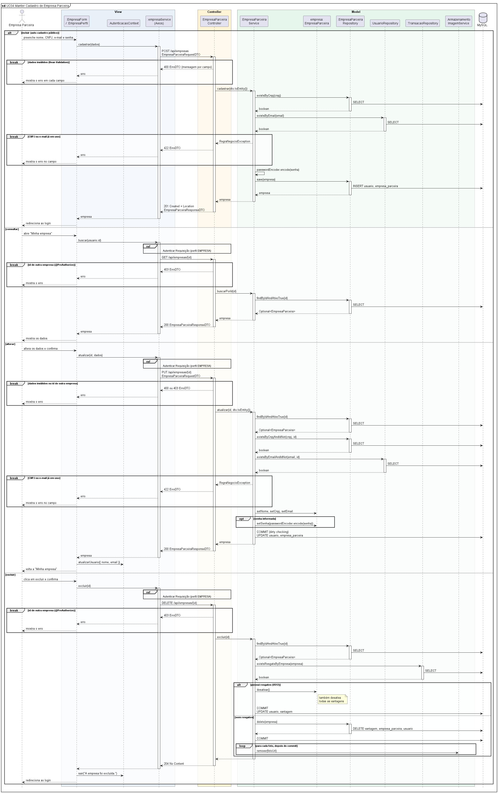
</details>

<details>
<summary><strong>UC05</strong> Manter Vantagens</summary>

Fonte: [`.puml`](docs/sprint-04/diagrama-sequencia-uc05-manter-vantagens.puml) · [`.pdf`](docs/sprint-04/diagrama-sequencia-uc05-manter-vantagens.pdf)

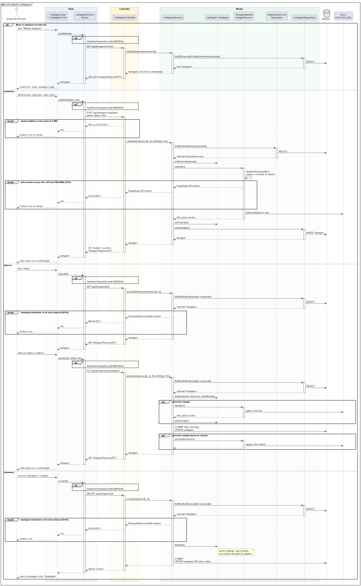
</details>

<details>
<summary><strong>UC06</strong> Enviar Moedas</summary>

Fonte: [`.puml`](docs/sprint-04/diagrama-sequencia-uc06-enviar-moedas.puml) · [`.pdf`](docs/sprint-04/diagrama-sequencia-uc06-enviar-moedas.pdf)

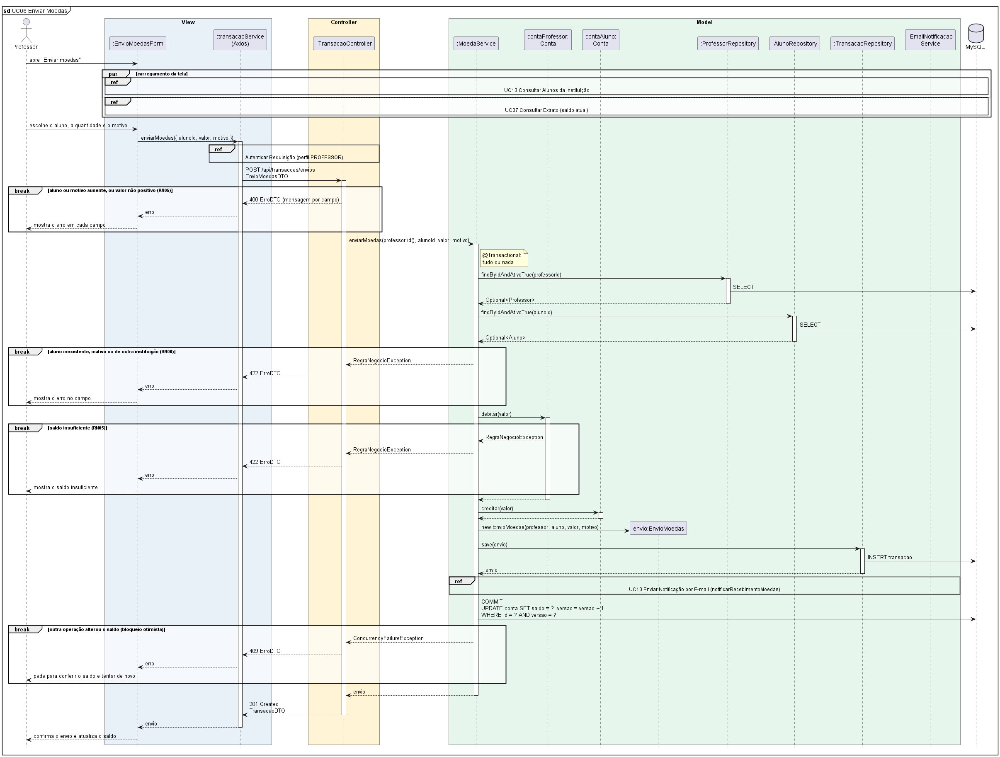
</details>

<details>
<summary><strong>UC07</strong> Consultar Extrato</summary>

Fonte: [`.puml`](docs/sprint-04/diagrama-sequencia-uc07-consultar-extrato.puml) · [`.pdf`](docs/sprint-04/diagrama-sequencia-uc07-consultar-extrato.pdf)

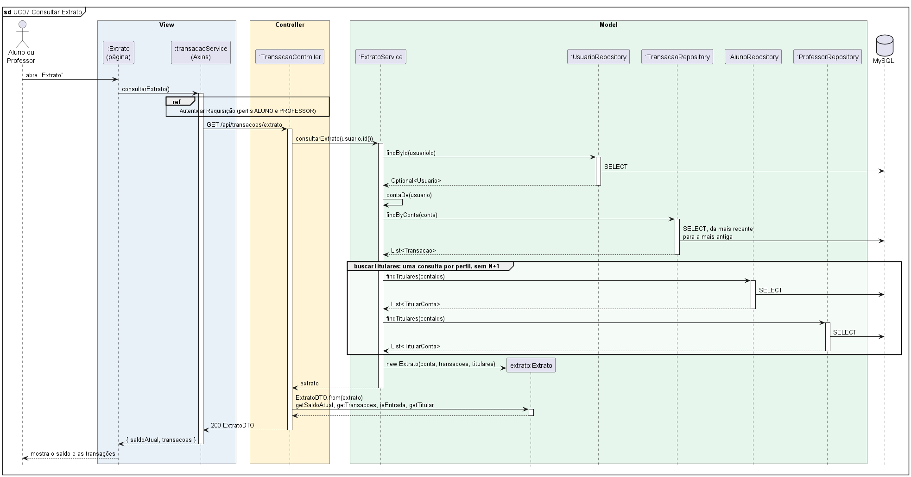
</details>

<details>
<summary><strong>UC08</strong> Consultar Vantagens</summary>

Fonte: [`.puml`](docs/sprint-04/diagrama-sequencia-uc08-consultar-vantagens.puml) · [`.pdf`](docs/sprint-04/diagrama-sequencia-uc08-consultar-vantagens.pdf)

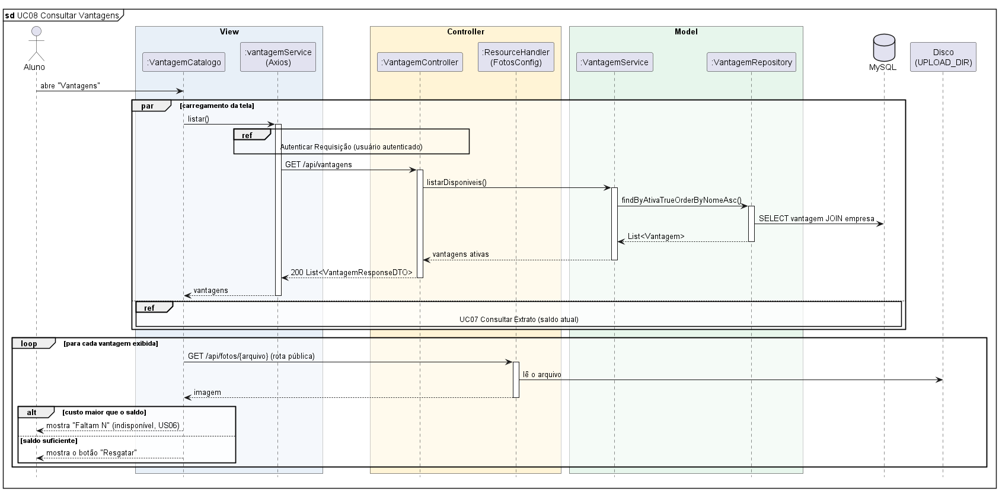
</details>

<details>
<summary><strong>UC09</strong> Resgatar Vantagem</summary>

Fonte: [`.puml`](docs/sprint-04/diagrama-sequencia-uc09-resgatar-vantagem.puml) · [`.pdf`](docs/sprint-04/diagrama-sequencia-uc09-resgatar-vantagem.pdf)


</details>

<details>
<summary><strong>UC10</strong> Enviar Notificação por E-mail</summary>

Fonte: [`.puml`](docs/sprint-04/diagrama-sequencia-uc10-enviar-notificacao-email.puml) · [`.pdf`](docs/sprint-04/diagrama-sequencia-uc10-enviar-notificacao-email.pdf)

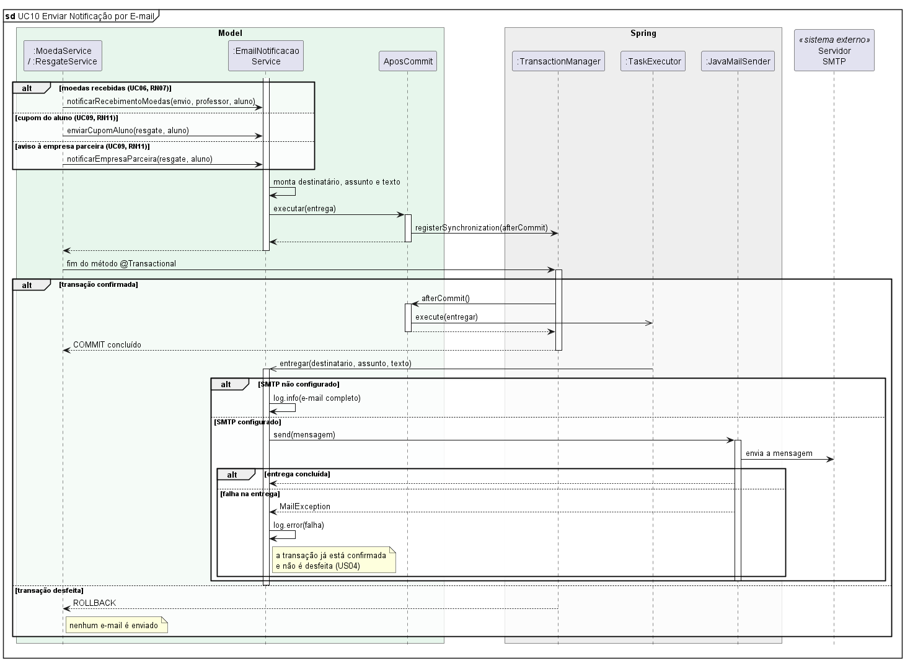
</details>

<details>
<summary><strong>UC11</strong> Creditar Moedas Semestrais</summary>

Fonte: [`.puml`](docs/sprint-04/diagrama-sequencia-uc11-creditar-moedas-semestrais.puml) · [`.pdf`](docs/sprint-04/diagrama-sequencia-uc11-creditar-moedas-semestrais.pdf)

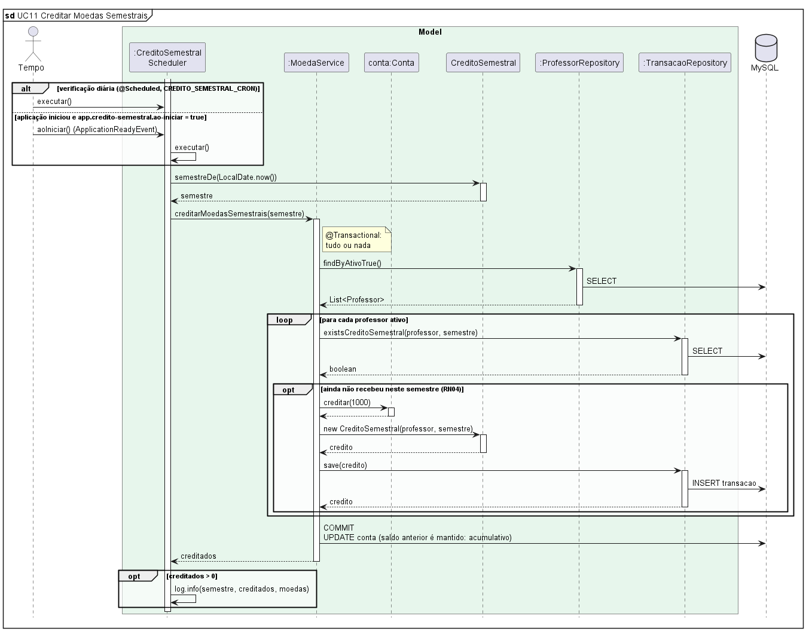
</details>

<details>
<summary><strong>UC12</strong> Gerar Código de Cupom</summary>

Fonte: [`.puml`](docs/sprint-04/diagrama-sequencia-uc12-gerar-codigo-cupom.puml) · [`.pdf`](docs/sprint-04/diagrama-sequencia-uc12-gerar-codigo-cupom.pdf)

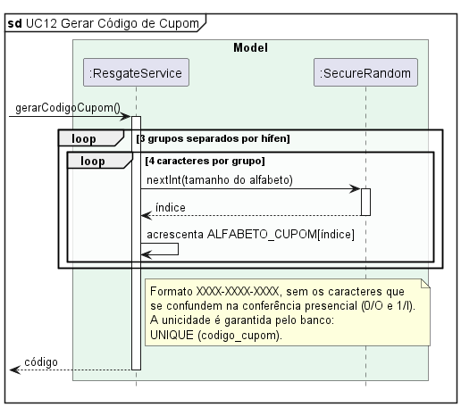
</details>

<details>
<summary><strong>UC13</strong> Consultar Alunos da Instituição</summary>

Fonte: [`.puml`](docs/sprint-04/diagrama-sequencia-uc13-consultar-alunos-instituicao.puml) · [`.pdf`](docs/sprint-04/diagrama-sequencia-uc13-consultar-alunos-instituicao.pdf)

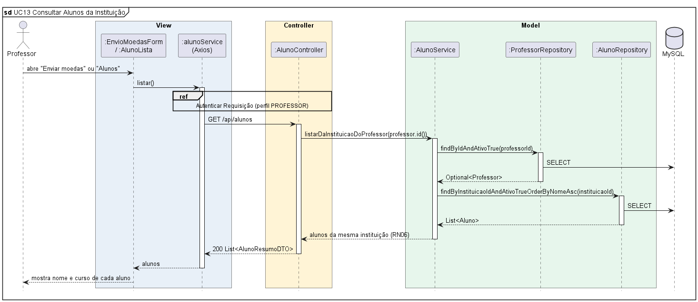
</details>

<details>
<summary><strong>UC14</strong> Consultar Empresas Parceiras</summary>

Fonte: [`.puml`](docs/sprint-04/diagrama-sequencia-uc14-consultar-empresas-parceiras.puml) · [`.pdf`](docs/sprint-04/diagrama-sequencia-uc14-consultar-empresas-parceiras.pdf)

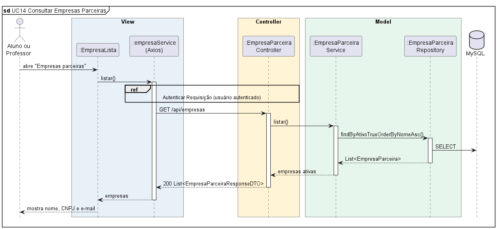
</details>
