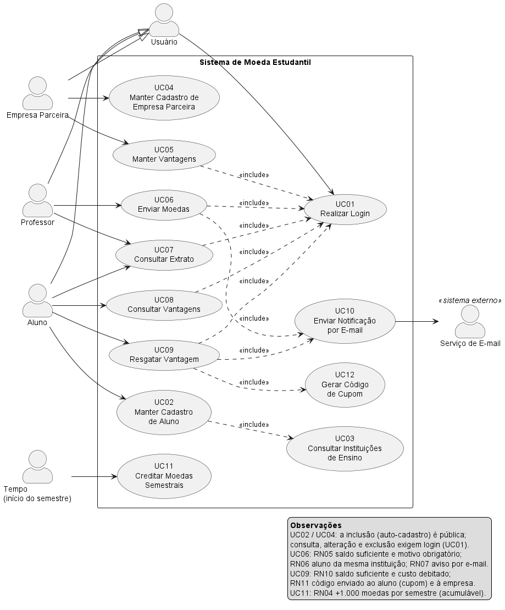
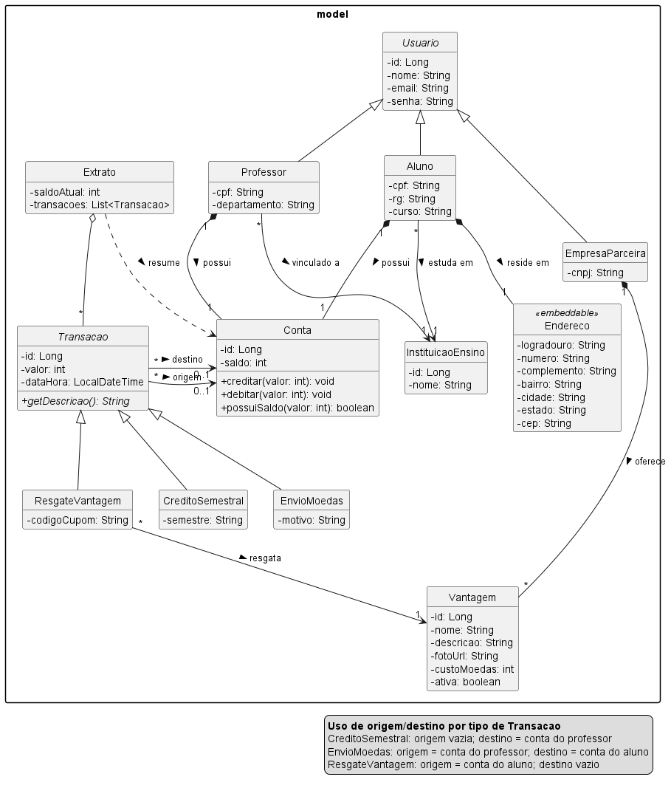
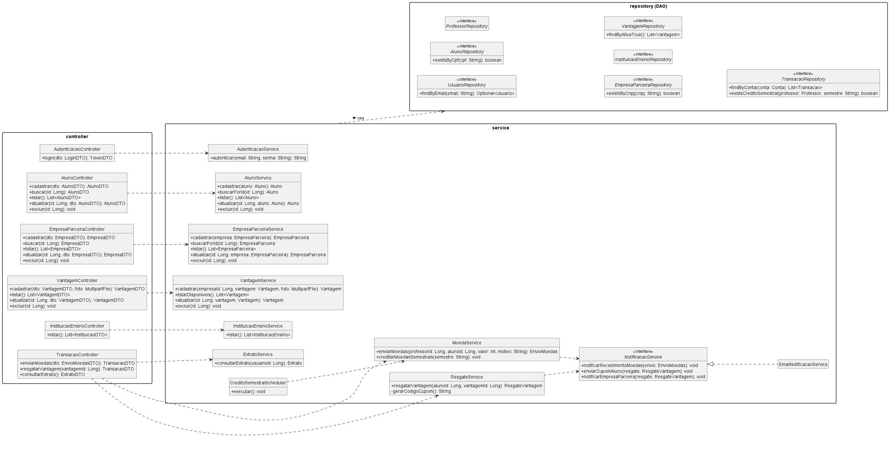
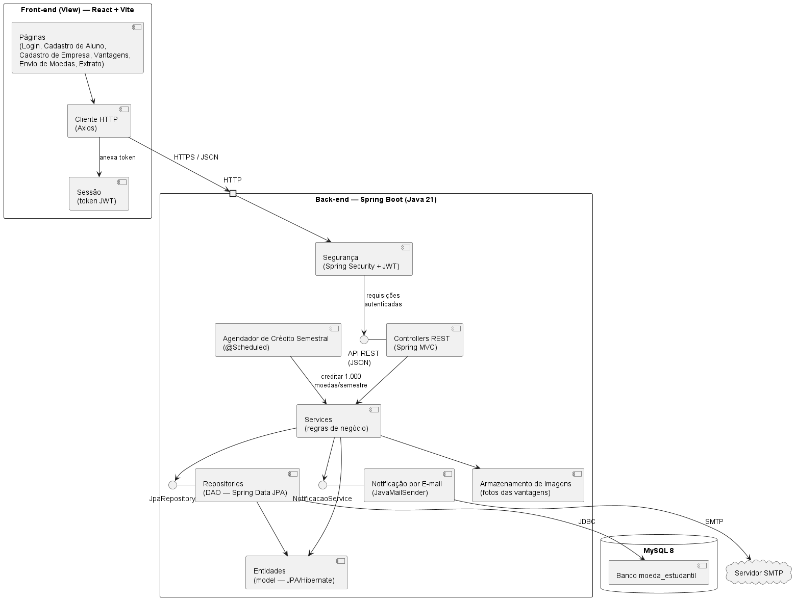

# Sistema de Moeda Estudantil — Projeto de Software

**PUC Minas — Engenharia de Software**
Laboratório 3 — Segundo Semestre/2026
Disciplina: Projeto de Software — Profa. Milena Menezes Adão
Integrantes: João Pedro Maciel de Oliveira

---

## Sumário

1. [Visão Geral](#1-visão-geral)
2. [Atores](#2-atores)
3. [Regras de Negócio](#3-regras-de-negócio)
4. [Casos de Uso](#4-casos-de-uso)
5. [Histórias de Usuário](#5-histórias-de-usuário)
6. [Diagrama de Classes](#6-diagrama-de-classes)
7. [Diagrama de Componentes](#7-diagrama-de-componentes)
8. [Estrutura do Repositório](#8-estrutura-do-repositório)
9. [Andamento das Sprints](#9-andamento-das-sprints)

---

## 1. Visão Geral

Sistema para estimular o reconhecimento do mérito estudantil por meio de uma **moeda virtual**. Professores distribuem moedas aos seus alunos como reconhecimento (bom comportamento, participação em aula etc.), e os alunos trocam essas moedas por **vantagens** (produtos e descontos) oferecidas por **empresas parceiras**.

### Tecnologias propostas

| Camada | Tecnologia |
|---|---|
| **View** (front-end) | React + Vite, Axios, React Router |
| **Controller** (back-end) | Java 21 + Spring Boot 3 — Spring Web (REST) |
| **Model** (back-end) | Services com as regras de negócio + entidades JPA |
| **Persistência** | Spring Data JPA / Hibernate (ORM) com repositórios no padrão DAO |
| **Banco de dados** | MySQL 8 |
| **Autenticação** | Spring Security + JWT, senhas armazenadas com BCrypt |
| **E-mail** | Spring Boot Mail (`JavaMailSender`) via SMTP |
| **Modelagem** | PlantUML |

**Arquitetura:** MVC, com o back-end organizado nas camadas `controller` → `service` → `repository` → `model`.

---

## 2. Atores

| Ator | Tipo | Descrição |
|---|---|---|
| **Aluno** | Primário | Cadastra-se no sistema, consulta o extrato, recebe moedas e as troca por vantagens. |
| **Professor** | Primário | Pré-cadastrado pela instituição. Recebe 1.000 moedas por semestre e as distribui aos seus alunos. |
| **Empresa Parceira** | Primário | Cadastra-se no sistema e mantém as vantagens oferecidas aos alunos. Recebe e-mail a cada resgate para conferência. |
| **Tempo** (início do semestre) | Secundário | Dispara o crédito semestral de moedas aos professores. |
| **Serviço de E-mail** | Secundário (externo) | Entrega as notificações de recebimento de moedas, os cupons de resgate e os avisos às empresas parceiras. |

> Aluno, Professor e Empresa Parceira são especializações de **Usuário**, que concentra o login (e-mail) e a senha.
>
> **Instituições de ensino** e **professores** não são atores com casos de uso de manutenção: são pré-cadastrados por carga inicial de dados, a partir da lista enviada pela instituição no momento da parceria.

---

## 3. Regras de Negócio

| ID | Regra |
|---|---|
| **RN01** | O cadastro de aluno exige nome, e-mail, CPF, RG, endereço, instituição de ensino e curso. CPF e e-mail são únicos no sistema. |
| **RN02** | As instituições de ensino participantes já estão pré-cadastradas; o aluno seleciona a sua no cadastro. |
| **RN03** | Os professores são pré-cadastrados (lista enviada pela instituição) com nome, CPF, departamento e a instituição à qual pertencem. Não há auto-cadastro de professor. |
| **RN04** | A cada semestre, cada professor recebe **1.000 moedas**, somadas ao saldo corrente (o saldo não distribuído é acumulado). O crédito ocorre uma única vez por semestre. |
| **RN05** | Para enviar moedas, o professor deve ter **saldo suficiente** e informar o aluno destinatário, a quantidade (inteiro positivo) e o **motivo** do reconhecimento (mensagem aberta, obrigatória). |
| **RN06** | O professor só pode enviar moedas a alunos da **mesma instituição** de ensino. |
| **RN07** | Ao receber moedas, o aluno é **notificado por e-mail**. |
| **RN08** | O extrato exibe o saldo atual e as transações da conta: para o professor, créditos semestrais e envios; para o aluno, recebimentos e resgates. |
| **RN09** | Uma vantagem possui nome, descrição, **foto** e **custo em moedas** (inteiro positivo), e pertence a uma empresa parceira. |
| **RN10** | Para resgatar uma vantagem, o aluno deve ter saldo suficiente; o custo é **debitado** do seu saldo. |
| **RN11** | Cada resgate gera um **código único**. É enviado um e-mail de cupom ao aluno e um e-mail à empresa parceira, ambos com esse código, para conferência na troca presencial. |
| **RN12** | Alunos, professores e empresas parceiras têm login e senha. Todas as funcionalidades exigem autenticação, exceto o próprio login e o auto-cadastro de aluno e de empresa parceira. |

> **Notas de modelagem**
> - O enunciado não lista e-mail para o professor, mas ele precisa de login; adotamos o **e-mail como login** para todos os usuários, por isso o atributo fica em `Usuario`.
> - **RN06** é a nossa leitura de "distribuídas aos *seus* alunos". Caso o entendimento mude, a regra fica isolada em `MoedaService` e o modelo não precisa ser alterado.
> - O crédito semestral é registrado como uma transação (`CreditoSemestral`), o que mantém o extrato do professor completo e impede crédito em duplicidade no mesmo semestre (RN04).

---

## 4. Casos de Uso

### 4.1 Diagrama

Fonte PlantUML: [`docs/sprint-01/casos-de-uso.puml`](docs/sprint-01/casos-de-uso.puml)



### 4.2 Lista de Casos de Uso

| ID | Caso de Uso | Ator Principal | Regras |
|---|---|---|---|
| UC01 | Realizar Login | Usuário (Aluno, Professor, Empresa Parceira) | RN12 |
| UC02 | Manter Cadastro de Aluno | Aluno | RN01, RN02 |
| UC03 | Consultar Instituições de Ensino | — (incluído por UC02) | RN02 |
| UC04 | Manter Cadastro de Empresa Parceira | Empresa Parceira | RN12 |
| UC05 | Manter Vantagens | Empresa Parceira | RN09 |
| UC06 | Enviar Moedas | Professor | RN05, RN06, RN07 |
| UC07 | Consultar Extrato | Aluno, Professor | RN08 |
| UC08 | Consultar Vantagens | Aluno | RN09 |
| UC09 | Resgatar Vantagem | Aluno | RN10, RN11 |
| UC10 | Enviar Notificação por E-mail | Serviço de E-mail (secundário) | RN07, RN11 |
| UC11 | Creditar Moedas Semestrais | Tempo (secundário) | RN04 |
| UC12 | Gerar Código de Cupom | — (incluído por UC09) | RN11 |

**Relacionamentos:**

- UC05, UC06, UC07, UC08 e UC09 **incluem** UC01 (Realizar Login).
- UC02 e UC04: a inclusão (auto-cadastro) é pública; consulta, alteração e exclusão exigem login (RN12).
- UC02 **inclui** UC03 — o aluno escolhe uma instituição pré-cadastrada.
- UC06 **inclui** UC10 — o aluno é notificado ao receber moedas.
- UC09 **inclui** UC12 e UC10 — o código é gerado e enviado ao aluno (cupom) e à empresa parceira.

---

## 5. Histórias de Usuário

### 5.1 Autenticação

#### US01 — Realizar login
> **Como** usuário do sistema (aluno, professor ou empresa parceira),
> **quero** acessar o sistema com meu e-mail e minha senha,
> **para que** somente eu realize operações na minha conta.

**Critérios de aceitação**
- Dado que informo credenciais válidas, então acesso a área correspondente ao meu perfil.
- Dado que informo e-mail ou senha incorretos, então recebo uma mensagem de erro genérica e continuo na tela de login.
- Nenhuma funcionalidade, exceto login e auto-cadastro, é acessível sem autenticação (RN12).

**Casos de uso:** UC01

---

### 5.2 Aluno

#### US02 — Cadastrar-me como aluno
> **Como** aluno,
> **quero** me cadastrar informando nome, e-mail, CPF, RG, endereço, instituição de ensino, curso e senha,
> **para que** eu possa participar do sistema de mérito e receber moedas.

**Critérios de aceitação**
- Todos os campos são obrigatórios (RN01).
- A instituição é escolhida de uma lista de instituições pré-cadastradas (RN02).
- O cadastro é recusado se o CPF ou o e-mail já estiverem em uso.
- Ao concluir, minha conta é criada com saldo de 0 moedas.

**Casos de uso:** UC02, UC03

#### US03 — Gerenciar meu cadastro de aluno
> **Como** aluno,
> **quero** consultar, alterar e excluir meus dados cadastrais,
> **para que** minhas informações estejam sempre corretas.

**Critérios de aceitação**
- Só tenho acesso aos meus próprios dados, após login.
- As mesmas validações do cadastro valem na alteração.
- A exclusão pede confirmação e encerra meu acesso ao sistema.

**Casos de uso:** UC02

#### US04 — Ser notificado ao receber moedas
> **Como** aluno,
> **quero** receber um e-mail sempre que um professor me enviar moedas,
> **para que** eu saiba que fui reconhecido e por qual motivo.

**Critérios de aceitação**
- O e-mail informa o professor, a quantidade de moedas e o motivo (RN07).
- Falha no envio do e-mail é registrada em log e não desfaz a transação.

**Casos de uso:** UC06, UC10

#### US05 — Consultar meu extrato
> **Como** aluno,
> **quero** consultar meu saldo e o histórico de moedas recebidas e trocadas,
> **para que** eu acompanhe quanto tenho disponível para resgate.

**Critérios de aceitação**
- O extrato exibe o saldo atual (RN08).
- Cada recebimento mostra data, professor, quantidade e motivo.
- Cada resgate mostra data, vantagem, custo e código do cupom.
- As transações são exibidas da mais recente para a mais antiga.

**Casos de uso:** UC07

#### US06 — Consultar vantagens disponíveis
> **Como** aluno,
> **quero** ver as vantagens oferecidas pelas empresas parceiras, com foto, descrição e custo,
> **para que** eu escolha em que trocar minhas moedas.

**Critérios de aceitação**
- Somente vantagens ativas são listadas.
- Cada vantagem exibe nome, descrição, foto, custo em moedas e empresa parceira (RN09).
- Vantagens com custo maior que o meu saldo aparecem indicadas como indisponíveis para mim.

**Casos de uso:** UC08

#### US07 — Resgatar uma vantagem
> **Como** aluno,
> **quero** trocar minhas moedas por uma vantagem,
> **para que** eu possa usufruir do benefício na empresa parceira.

**Critérios de aceitação**
- O resgate é recusado se meu saldo for menor que o custo da vantagem (RN10).
- Em caso de sucesso, o custo é debitado do meu saldo e o resgate aparece no meu extrato.
- O sistema gera um código único de cupom (RN11).
- Recebo um e-mail de cupom com o código, a vantagem e a empresa parceira.

**Casos de uso:** UC09, UC12, UC10

---

### 5.3 Professor

#### US08 — Receber moedas semestrais
> **Como** professor,
> **quero** receber 1.000 moedas no início de cada semestre, somadas ao saldo que eu ainda tiver,
> **para que** eu possa reconhecer meus alunos ao longo do semestre.

**Critérios de aceitação**
- No início do semestre, 1.000 moedas são creditadas na conta de cada professor (RN04).
- O saldo não distribuído no semestre anterior é mantido (acumulativo).
- O crédito não ocorre duas vezes no mesmo semestre.
- O crédito aparece no meu extrato.

**Casos de uso:** UC11

#### US09 — Enviar moedas a um aluno
> **Como** professor,
> **quero** enviar moedas a um aluno informando a quantidade e o motivo,
> **para que** ele seja reconhecido pelo bom comportamento ou pela participação em aula.

**Critérios de aceitação**
- Só posso selecionar alunos da minha instituição (RN06).
- A quantidade deve ser um inteiro positivo e não pode exceder meu saldo (RN05).
- O motivo é obrigatório (RN05).
- Em caso de sucesso, o valor é debitado do meu saldo e creditado no saldo do aluno, e o aluno é notificado por e-mail (RN07).

**Casos de uso:** UC06, UC10

#### US10 — Consultar meu extrato
> **Como** professor,
> **quero** consultar meu saldo e o histórico de moedas recebidas e enviadas,
> **para que** eu acompanhe como distribuí as moedas entre os alunos.

**Critérios de aceitação**
- O extrato exibe o saldo atual (RN08).
- Cada envio mostra data, aluno, quantidade e motivo.
- Cada crédito semestral mostra o semestre e a quantidade.

**Casos de uso:** UC07

---

### 5.4 Empresa Parceira

#### US11 — Cadastrar minha empresa como parceira
> **Como** empresa parceira,
> **quero** me cadastrar informando nome, CNPJ, e-mail e senha,
> **para que** eu possa oferecer vantagens aos alunos.

**Critérios de aceitação**
- Todos os campos são obrigatórios.
- O cadastro é recusado se o CNPJ ou o e-mail já estiverem em uso.

**Casos de uso:** UC04

#### US12 — Gerenciar o cadastro da empresa
> **Como** empresa parceira,
> **quero** consultar, alterar e excluir os dados da minha empresa,
> **para que** as informações exibidas aos alunos estejam atualizadas.

**Critérios de aceitação**
- Só tenho acesso aos dados da minha empresa, após login.
- Ao excluir a empresa, suas vantagens deixam de ser exibidas aos alunos; o histórico de resgates é mantido nos extratos.

**Casos de uso:** UC04

#### US13 — Cadastrar vantagens
> **Como** empresa parceira,
> **quero** cadastrar vantagens com nome, descrição, foto e custo em moedas,
> **para que** os alunos possam trocá-las por suas moedas.

**Critérios de aceitação**
- Nome, descrição, foto e custo são obrigatórios (RN09).
- O custo deve ser um inteiro positivo.
- A foto aceita apenas formatos de imagem (JPG ou PNG).

**Casos de uso:** UC05

#### US14 — Gerenciar minhas vantagens
> **Como** empresa parceira,
> **quero** alterar e desativar as vantagens que ofereço,
> **para que** o catálogo reflita o que ainda posso entregar.

**Critérios de aceitação**
- Só posso alterar vantagens da minha empresa.
- Vantagens desativadas deixam de aparecer para os alunos, mas continuam nos extratos de quem já as resgatou.

**Casos de uso:** UC05

#### US15 — Ser notificada sobre resgates
> **Como** empresa parceira,
> **quero** receber um e-mail sempre que um aluno resgatar uma das minhas vantagens,
> **para que** eu possa conferir o cupom na troca presencial.

**Critérios de aceitação**
- O e-mail contém o código do cupom, a vantagem resgatada e o nome do aluno (RN11).
- O código é o mesmo enviado ao aluno.

**Casos de uso:** UC09, UC10

### 5.5 Rastreabilidade

| História | Casos de Uso | Regras |
|---|---|---|
| US01 | UC01 | RN12 |
| US02, US03 | UC02, UC03 | RN01, RN02 |
| US04 | UC06, UC10 | RN07 |
| US05, US10 | UC07 | RN08 |
| US06 | UC08 | RN09 |
| US07 | UC09, UC10, UC12 | RN10, RN11 |
| US08 | UC11 | RN04 |
| US09 | UC06, UC10 | RN05, RN06, RN07 |
| US11, US12 | UC04 | RN12 |
| US13, US14 | UC05 | RN09 |
| US15 | UC09, UC10 | RN11 |

---

## 6. Diagrama de Classes

O modelo de classes está dividido em duas visões, para manter a legibilidade.

### 6.1 Modelo de Domínio (`model`)

Fonte PlantUML: [`docs/sprint-01/diagrama-classes.puml`](docs/sprint-01/diagrama-classes.puml)



| Classe | Responsabilidade |
|---|---|
| **Usuario** (abstrata) | Concentra `id`, `nome`, `email` (login) e `senha` (RN12). Base de `Aluno`, `Professor` e `EmpresaParceira`. |
| **Aluno** | CPF, RG, curso, endereço e instituição de ensino (RN01, RN02). Possui uma `Conta`. |
| **Professor** | CPF, departamento e instituição de ensino (RN03). Possui uma `Conta`. |
| **EmpresaParceira** | CNPJ; oferece várias `Vantagem`s. |
| **InstituicaoEnsino** | Instituição pré-cadastrada à qual alunos e professores estão vinculados. |
| **Endereco** | Objeto de valor incorporado ao aluno (`@Embeddable`). |
| **Conta** | Saldo de moedas do aluno ou do professor; `creditar`, `debitar` e `possuiSaldo` garantem que o saldo nunca fique negativo. |
| **Transacao** (abstrata) | Movimentação de moedas, com `valor`, `dataHora`, conta de origem e conta de destino. |
| **CreditoSemestral** | Crédito de 1.000 moedas ao professor em um `semestre` (RN04). |
| **EnvioMoedas** | Moedas do professor para o aluno, com `motivo` obrigatório (RN05). |
| **ResgateVantagem** | Troca de moedas do aluno por uma `Vantagem`, com `codigoCupom` único (RN10, RN11). |
| **Vantagem** | Nome, descrição, foto, custo em moedas e situação ativa/inativa (RN09). |
| **Extrato** | Objeto não persistido que reúne saldo e transações de uma conta (RN08). |

### 6.2 Camadas MVC (`controller` / `service` / `repository`)

Fonte PlantUML: [`docs/sprint-01/diagrama-classes-camadas.puml`](docs/sprint-01/diagrama-classes-camadas.puml)



| Camada | Pacote | Responsabilidade |
|---|---|---|
| **Controller** | `controller` | Endpoints REST consumidos pelo front-end. Convertem DTOs e delegam aos services, sem regras de negócio. |
| **Service** | `service` | Regras de negócio (RN01–RN12), transações e notificações. |
| **Repository (DAO)** | `repository` | Interfaces Spring Data JPA de acesso ao banco, uma por agregado. |
| **Model** | `model` | Entidades JPA da seção 6.1. |

### 6.3 Services e Repositórios Utilizados

| Service | Responsabilidade | Repositórios |
|---|---|---|
| **AutenticacaoService** | Valida e-mail e senha e emite o token JWT (UC01). | `UsuarioRepository` |
| **AlunoService** | CRUD de aluno, com validação de CPF e e-mail únicos (UC02). | `AlunoRepository` |
| **EmpresaParceiraService** | CRUD de empresa parceira, com validação de CNPJ e e-mail únicos (UC04). | `EmpresaParceiraRepository` |
| **VantagemService** | CRUD de vantagens e armazenamento da foto (UC05, UC08). | `VantagemRepository` |
| **InstituicaoEnsinoService** | Lista as instituições pré-cadastradas (UC03). | `InstituicaoEnsinoRepository` |
| **MoedaService** | Envio de moedas (UC06; RN05–RN07) e crédito semestral (UC11; RN04). | `ProfessorRepository`, `AlunoRepository`, `TransacaoRepository` |
| **ResgateService** | Resgate de vantagem e geração do código do cupom (UC09, UC12; RN10–RN11). | `AlunoRepository`, `VantagemRepository`, `TransacaoRepository` |
| **ExtratoService** | Monta o `Extrato` do usuário autenticado (UC07; RN08). | `UsuarioRepository`, `TransacaoRepository` |
| **NotificacaoService** / **EmailNotificacaoService** | Interface e implementação SMTP dos e-mails do sistema (UC10). | — |
| **CreditoSemestralScheduler** | Tarefa agendada que aciona `MoedaService.creditarMoedasSemestrais` no início de cada semestre (UC11). | — |

---

## 7. Diagrama de Componentes

Fonte PlantUML: [`docs/sprint-01/diagrama-componentes.puml`](docs/sprint-01/diagrama-componentes.puml)



| Componente | Papel no MVC | Descrição |
|---|---|---|
| **Páginas (React)** | View | Telas de login, cadastro de aluno, cadastro de empresa, vantagens, envio de moedas e extrato. |
| **Cliente HTTP (Axios)** | View | Chama a API REST e anexa o token JWT guardado na sessão. |
| **Segurança (Spring Security + JWT)** | — | Filtro que valida o token antes de cada requisição chegar aos controllers (RN12). |
| **Controllers REST** | Controller | Expõem a API REST/JSON e delegam aos services. |
| **Services** | Model | Regras de negócio; dependem das interfaces `JpaRepository` e `NotificacaoService`, não das implementações. |
| **Repositories (DAO)** | Model | Acesso ao MySQL via Spring Data JPA/Hibernate. |
| **Entidades** | Model | Classes do modelo de domínio mapeadas com JPA. |
| **Notificação por E-mail** | Model | Implementa `NotificacaoService` e envia e-mails pelo servidor SMTP. |
| **Agendador de Crédito Semestral** | Model | Executa o crédito de 1.000 moedas por semestre (RN04). |
| **Armazenamento de Imagens** | Model | Guarda as fotos das vantagens; a entidade guarda apenas a URL. |
| **MySQL 8** | — | Banco de dados relacional da aplicação. |
| **Servidor SMTP** | — | Serviço externo de entrega de e-mails. |

---

## 8. Estrutura do Repositório

```
.
├── README.md
└── docs/
    └── sprint-01/
        ├── casos-de-uso.puml / .png / .pdf
        ├── diagrama-classes.puml / .png / .pdf            # modelo de domínio
        ├── diagrama-classes-camadas.puml / .png / .pdf    # controller / service / repository
        └── diagrama-componentes.puml / .png / .pdf
```

Cada sprint terá sua própria pasta em `docs/`, preservando todas as versões dos modelos UML, conforme exigido no enunciado. Cada diagrama tem a fonte PlantUML (`.puml`), a imagem (`.png`) e uma versão em PDF vetorial (`.pdf`). Para regerar as imagens a partir das fontes:

```
java -jar plantuml.jar -charset UTF-8 -tpng docs/sprint-01/*.puml
```

> Os PDFs foram gerados a partir da exportação SVG do PlantUML (`-tsvg`) e impressos via navegador, pois a exportação `-tpdf` exige bibliotecas adicionais (Apache Batik/FOP).

---

## 9. Andamento das Sprints

| Sprint | Entregas | Status |
|---|---|---|
| **Lab03S01** | Diagrama de Casos de Uso, Histórias de Usuário, Diagrama de Classes e Diagrama de Componentes | ✅ Entregue |
| **Lab03S02** | Modelo ER, estratégia de acesso ao banco (ORM/DAO), CRUDs de aluno e empresa parceira (versão inicial: front-end e comunicação com back-end) | ⏳ Pendente |
| **Lab03S03** | CRUDs de aluno e empresa parceira (versão final), apresentação da arquitetura e da camada de persistência (slides) | ⏳ Pendente |
